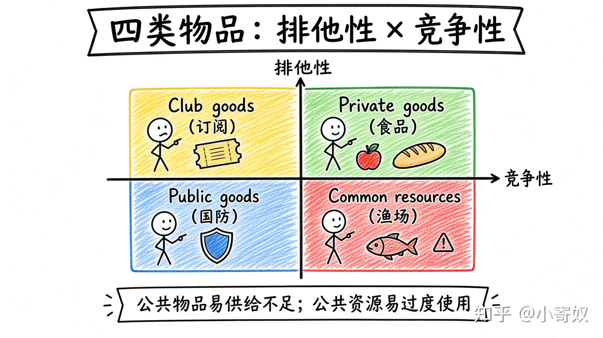

# 05｜排他性、竞争性与四类物品

- 所属单元：Unit 05
- 建议用时：15 分钟
- 本节只解决：**为什么有些物品市场容易收费，有些却容易被过度使用或供给不足？**
- 导航：[上一节](04_coase_transaction_cost.md) · [返回单元首页](README.md) · [下一节](06_free_rider_commons.md)

## 0～2 分钟：主动回忆

> 为什么有些物品市场容易收费，有些却容易被过度使用或供给不足？

## 本节术语

| 中文术语 | English | 缩写 | 通俗解释 |
|---|---|---|---|
| 排他性 | Excludability | 无通用缩写 | 能否阻止未付费者使用某种物品。 |
| 消费竞争性 | Rivalry in Consumption | 无通用缩写 | 一个人使用是否减少他人可使用的数量。 |
| 公共物品 | Public Good | 无通用缩写 | 通常同时具有非排他性和非竞争性的物品。 |
| 公共资源 | Common Resource | 无通用缩写 | 通常非排他但具有消费竞争性的资源。 |

> 第一次出现记住「中文（English, 缩写）」；无公认缩写就写「无通用缩写」，不要自造。

## 2～9 分钟：核心内容

排他性（Excludability，无通用缩写）问能否阻止未付费者；消费竞争性（Rivalry in Consumption，无通用缩写）问一人使用是否减少他人可用量。

四类：私人物品（可排他、有竞争）；俱乐部物品（可排他、低竞争）；公共物品（Public Good：非排他、非竞争）；公共资源（Common Resource：非排他、有竞争）。分类决定主问题：公共物品易供给不足，公共资源易过度使用。

## 9～12 分钟：最小例子

不拥堵收费高速可排他、暂时低竞争（俱乐部物品）；拥堵后竞争性增强。

## 12～14 分钟：你来做

分类：开源软件、城市路灯、地下水、付费视频平台。每项说明排他性与竞争性，不只贴标签。

## 14～15 分钟：费曼复述

> 公共物品通常 ______ 排他、______ 竞争；公共资源通常 ______ 排他、______ 竞争。

## 适用边界

物品属性会随技术与拥堵变化；加密、收费系统或容量约束都可能改分类。

## 完成证据

- [ ] 能说出本节英文术语与缩写
- [ ] 完成最小例子
- [ ] 保留了自己的判断过程
- [ ] 一句话复述与疑问已写入[工作簿](../workbook.md)
