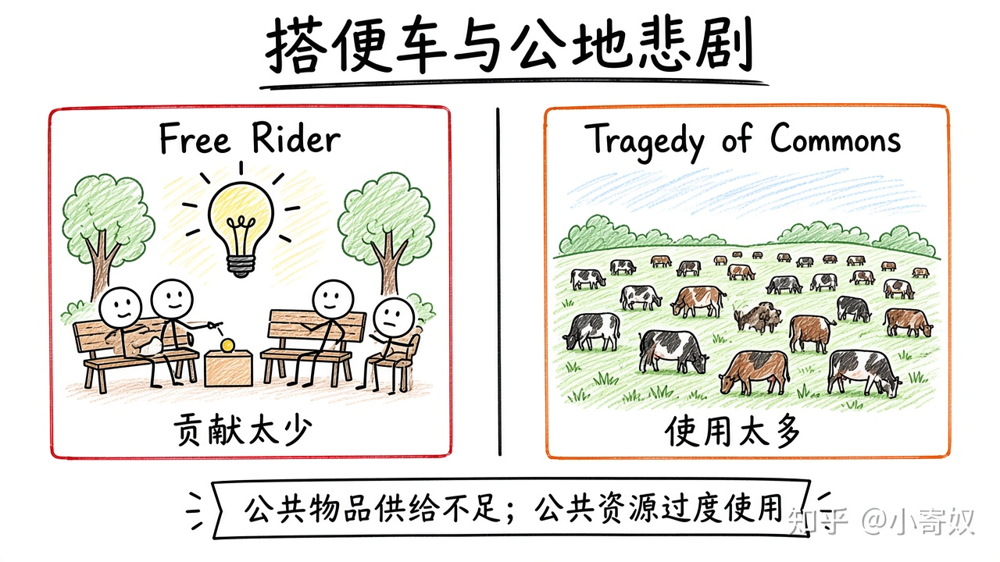

# 06｜搭便车与公地悲剧

- 所属单元：Unit 05
- 建议用时：15 分钟
- 本节只解决：**为什么公共物品供给不足，而公共资源却容易被过度使用？**
- 导航：[上一节](05_goods_classification.md) · [返回单元首页](README.md) · [下一节](07_cba_tax_design.md)

## 0～2 分钟：主动回忆

> 为什么公共物品供给不足，而公共资源却容易被过度使用？

## 本节术语

| 中文术语 | English | 缩写 | 通俗解释 |
|---|---|---|---|
| 搭便车者 | Free Rider | 无通用缩写 | 享受公共物品收益但不愿付费的人。 |
| 公地悲剧 | Tragedy of the Commons | 无通用缩写 | 公共资源因个人忽视对他人的成本而被过度使用。 |
| 公共物品 | Public Good | 无通用缩写 | 通常同时具有非排他性和非竞争性的物品。 |
| 公共资源 | Common Resource | 无通用缩写 | 通常非排他但具有消费竞争性的资源。 |

> 第一次出现记住「中文（English, 缩写）」；无公认缩写就写「无通用缩写」，不要自造。

## 2～9 分钟：核心内容

搭便车者（Free Rider，无通用缩写）享受公共物品收益却不愿付费 → 私人市场可能供给不足。

公地悲剧（Tragedy of the Commons，无通用缩写）：个人使用拿私人收益，却把拥堵/枯竭成本分摊给所有人 → 使用过多。

方向相反：公共物品「贡献太少」，公共资源「使用太多」。工具可含税收筹资、使用费、配额、产权、社区规则与监测。

## 9～12 分钟：最小例子

开放草场上，每个牧民多放一头牛获大部分收益，却只承担草场损害的一小部分 → 总放牧过量。

## 12～14 分钟：你来做

分析城市道路拥堵：私人收益、外部成本、拥堵费，以及为何免费通行会过度使用。

## 14～15 分钟：费曼复述

> 搭便车导致公共物品 ______；公地悲剧导致公共资源 ______，因为私人决策没有承担全部 ______。

## 适用边界

社区规范与重复互动有时能治理公共资源，不能假定只能私有化或政府命令。

## 完成证据

- [ ] 能说出本节英文术语与缩写
- [ ] 完成最小例子
- [ ] 保留了自己的判断过程
- [ ] 一句话复述与疑问已写入[工作簿](../workbook.md)
