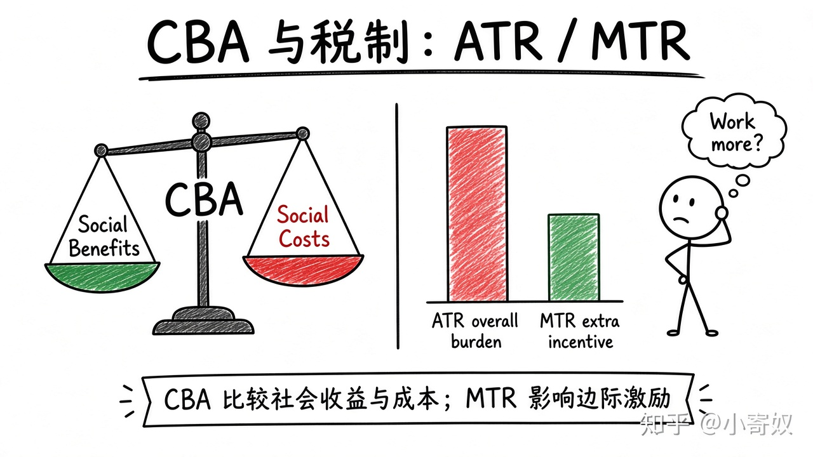

# 07｜成本收益分析与税制取舍

- 所属单元：Unit 05
- 建议用时：15 分钟
- 本节只解决：**怎样比较公共项目收益，并区分税制的效率与公平？**
- 导航：[上一节](06_free_rider_commons.md) · [返回单元首页](README.md) · [下一节](08_unit_review.md)

## 0～2 分钟：主动回忆

> 怎样比较公共项目收益，并区分税制的效率与公平？

## 本节术语

| 中文术语 | English | 缩写 | 通俗解释 |
|---|---|---|---|
| 成本收益分析 | Cost-benefit Analysis | CBA | 将政策的社会收益与社会成本系统比较。 |
| 边际税率 | Marginal Tax Rate | MTR | 新增一单位收入需要缴纳的税率。 |
| 平均税率 | Average Tax Rate | ATR | 总税额占总收入的比例。 |
| 效率 | Efficiency | 无通用缩写 | 资源配置使总剩余尽可能大。 |
| 公平 | Equity | 无通用缩写 | 经济成果如何在不同主体之间分配的价值问题。 |

> 第一次出现记住「中文（English, 缩写）」；无公认缩写就写「无通用缩写」，不要自造。

## 2～9 分钟：核心内容

成本收益分析（Cost-benefit Analysis, CBA）比较社会收益与社会成本，须计入时间、健康、环境与机会成本，不能只看政府现金流。

平均税率（Average Tax Rate, ATR）= 总税额/总收入，衡量总体负担；边际税率（Marginal Tax Rate, MTR）影响额外工作、投资与申报激励。税制同时看效率与公平：更高 MTR 可能增强再分配，也可能改变行为。

## 9～12 分钟：最小例子

公共道路节省通勤、减少事故，也有建设、维护与环境成本。只看收费收入会遗漏主要社会收益与成本。

## 12～14 分钟：你来做

为城市自动驾驶示范区列出三项社会收益、三项社会成本、一项难货币化影响，并区分实证估计与价值判断。

## 14～15 分钟：费曼复述

> CBA 比较 ______；ATR 衡量总体税负，MTR 影响 ______；税制设计同时考虑效率与 ______。

## 适用边界

生命、时间或生态货币化有伦理与测量争议，应报告假设、敏感性与不同群体影响。

## 完成证据

- [ ] 能说出本节英文术语与缩写
- [ ] 完成最小例子
- [ ] 保留了自己的判断过程
- [ ] 一句话复述与疑问已写入[工作簿](../workbook.md)
