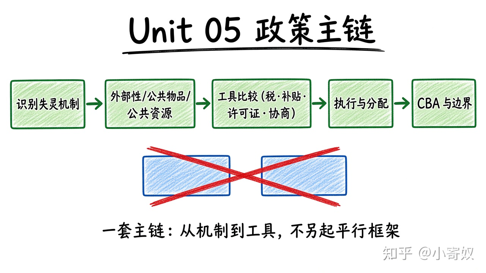

# 08｜单元复盘：市场失灵与公共政策

- 所属单元：Unit 05
- 建议用时：15 分钟
- 本节只解决：**能否从市场失灵机制出发选择政策，而不是先站队？**
- 导航：[上一节](07_cba_tax_design.md) · [返回单元首页](README.md)

## 0～2 分钟：主动回忆

> 能否从市场失灵机制出发选择政策，而不是先站队？

## 本节术语（复用）

| 中文术语 | English | 缩写 |
|---|---|---|
| 外部性 | Externality | 无通用缩写 |
| 庇古税 | Pigouvian Tax | 无通用缩写 |
| 公共物品 | Public Good | 无通用缩写 |
| 公地悲剧 | Tragedy of the Commons | 无通用缩写 |
| 成本收益分析 | Cost-benefit Analysis | CBA |

## 2～9 分钟：核心内容

闭卷回忆这一条主线（**一套流程，不要另起平行方案**）：



```text
识别失灵机制
→ 外部性 / 公共物品 / 公共资源
→ 工具比较（税·补贴·许可证·协商）
→ 执行成本与分配影响
→ CBA 与适用边界
```

政策比较至少写：目标、机制、所需信息、执行成本、规避方式、受益者与受损者。

## 9～12 分钟：最小例子

城市拥堵可用拥堵费内部化外部成本，也可用限行或公交投入；信息需求、分配影响与执行成本不同。

## 12～14 分钟：你来做

闭卷：①画 MSC/MPC 或 MSB/MPB；②比较税与许可证；③分类四种物品；④解释搭便车与公地悲剧；⑤完成一个迷你 CBA。

## 14～15 分钟：费曼复述

> 政策应从 ______ 的具体机制出发，比较工具的激励、信息、执行和 ______，而不是只说市场或政府更好。

## 适用边界

单一模型不能覆盖所有制度与伦理问题。结论要写明数据缺口、价值取舍和可能的政府失灵。

## 完成证据

- [ ] 能说出本节英文术语与缩写
- [ ] 完成最小例子
- [ ] 保留了自己的判断过程
- [ ] 一句话复述与疑问已写入[工作簿](../workbook.md)
