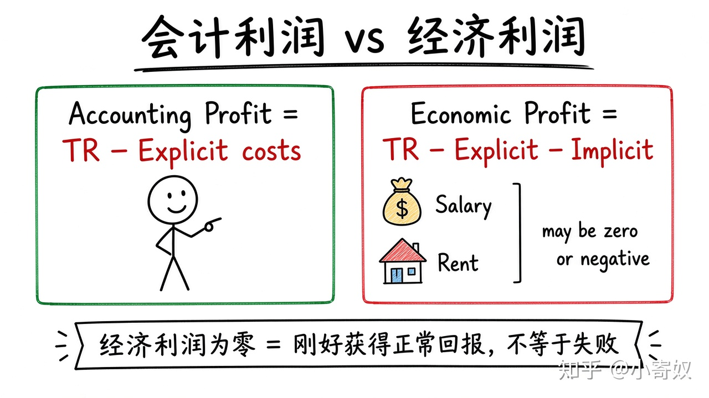

# 01｜收益、成本与两种利润

- 所属单元：Unit 06
- 建议用时：15 分钟
- 本节只解决：**一家企业账面盈利时，为什么经济利润仍可能为零或为负？**
- 导航：[返回单元首页](README.md) · [下一节](02_production_function_marginal_product.md)

## 0～2 分钟：主动回忆

> 一家企业账面盈利时，为什么经济利润仍可能为零或为负？

## 本节术语

| 中文术语 | English | 缩写 | 通俗解释 |
|---|---|---|---|
| 总收益 | Total Revenue | TR | 销售收入，等于价格乘以销量：TR=P×Q。 |
| 总成本 | Total Cost | TC | 企业为生产全部产出承担的机会成本。 |
| 利润 | Profit | π | 总收益减总成本：π=TR−TC。 |
| 显性成本 | Explicit Cost | 无通用缩写 | 需要直接支付货币的投入成本。 |
| 隐性成本 | Implicit Cost | 无通用缩写 | 使用自有资源所放弃的最佳替代收益。 |
| 会计利润 | Accounting Profit | 无通用缩写 | 总收益减去显性成本。 |
| 经济利润 | Economic Profit | 无通用缩写 | 总收益减去显性成本和隐性成本。 |

> 第一次出现记住「中文（English, 缩写）」；无公认缩写就写「无通用缩写」，不要自造。

## 2～9 分钟：核心内容

总收益（Total Revenue, TR）=P×Q。经济学中的总成本（Total Cost, TC）含全部资源的机会成本。利润（Profit, π）=TR−TC。

显性成本是直接货币支出；隐性成本是自有资源的最佳替代收益。会计利润只减显性成本；经济利润还减隐性成本。经济利润为零 ≠ 失败，而是刚好获得与最佳替代相当的正常回报。

## 9～12 分钟：最小例子

小店 TR=50 万，显性成本 35 万 → 会计利润 15 万。店主放弃年薪 12 万、房屋可租 5 万 → 隐性成本 17 万，经济利润 −2 万。

## 12～14 分钟：你来做

项目 TR=100 万，现金成本 70 万，放弃工资 20 万，自有资金可获利 8 万。计算会计利润与经济利润。

## 14～15 分钟：费曼复述

> 会计利润只减 ______；经济利润还减 ______。π=______−______。

## 适用边界

机会成本估计可能不确定。决策应使用与当前选择相关的可避免成本与未来收益。

## 完成证据

- [ ] 能说出本节英文术语与缩写
- [ ] 完成最小例子
- [ ] 保留了自己的判断过程
- [ ] 一句话复述与疑问已写入[工作簿](../workbook.md)
