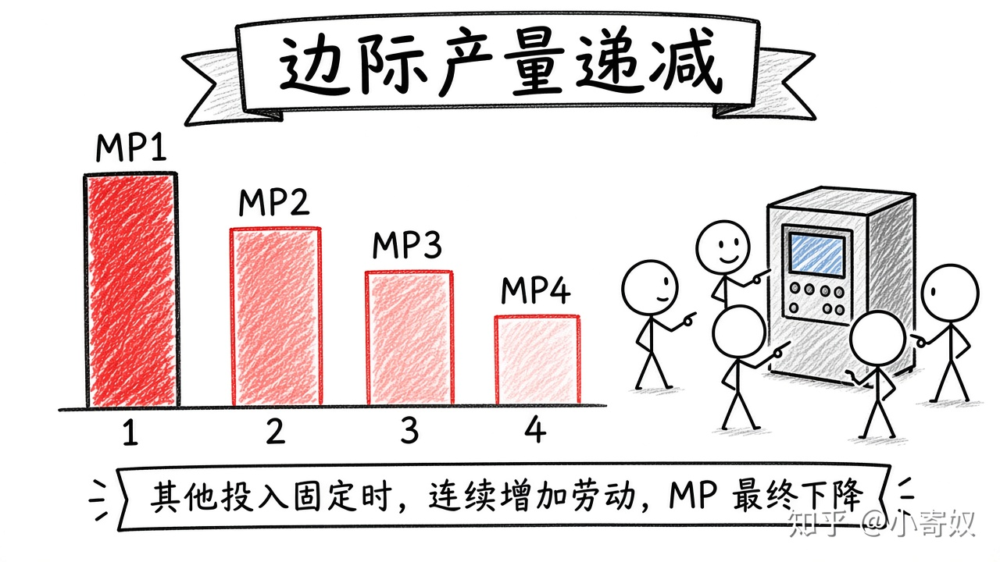

# 02｜生产函数与边际产量

- 所属单元：Unit 06
- 建议用时：15 分钟
- 本节只解决：**为什么团队继续增加人员后，新增产出通常会下降？**
- 导航：[上一节](01_revenue_cost_profit.md) · [返回单元首页](README.md) · [下一节](03_fixed_variable_costs.md)

## 0～2 分钟：主动回忆

> 为什么团队继续增加人员后，新增产出通常会下降？

## 本节术语

| 中文术语 | English | 缩写 | 通俗解释 |
|---|---|---|---|
| 生产函数 | Production Function | PF | 投入数量与最大可生产产出之间的关系。 |
| 边际产量 | Marginal Product | MP | 增加一单位投入带来的额外产出。 |
| 边际产量递减 | Diminishing Marginal Product | DMP | 其他投入固定时，连续增加某种投入，其边际产量最终下降。 |

> 第一次出现记住「中文（English, 缩写）」；无公认缩写就写「无通用缩写」，不要自造。

## 2～9 分钟：核心内容

生产函数（Production Function, PF）连接投入与最大产出。边际产量（Marginal Product, MP）=ΔQ/ΔL。

边际产量递减（Diminishing Marginal Product, DMP）：其他投入固定时，连续增加一种投入，MP 最终下降——不是后来的人更差，而是固定设备、管理与接口成为瓶颈。MP 下降会使新增产出的边际成本上升。

## 9～12 分钟：最小例子

固定一套测试环境：第 1～4 名工程师分别增加 10、8、5、2 个测试 → MP 递减。

## 12～14 分钟：你来做

劳动 0–4 人对应产出 0、12、22、29、33。计算各人 MP，并指出 DMP 从何处开始。

## 14～15 分钟：费曼复述

> PF 连接 ______ 与 ______；MP 表示 ______；其他投入固定时，MP 最终可能 ______。

## 适用边界

技术、资本与组织变化可使生产函数移动；不要把短期 DMP 误解为长期技术永不进步。

## 完成证据

- [ ] 能说出本节英文术语与缩写
- [ ] 完成最小例子
- [ ] 保留了自己的判断过程
- [ ] 一句话复述与疑问已写入[工作簿](../workbook.md)
