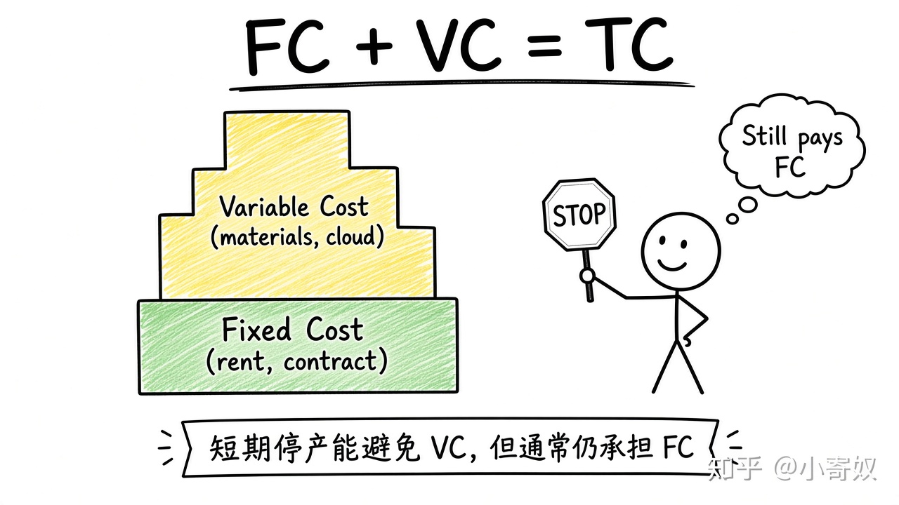

# 03｜固定成本、可变成本与总成本

- 所属单元：Unit 06
- 建议用时：15 分钟
- 本节只解决：**哪些成本会随产量变化，哪些短期内即使停产也要承担？**
- 导航：[上一节](02_production_function_marginal_product.md) · [返回单元首页](README.md) · [下一节](04_average_marginal_cost.md)

## 0～2 分钟：主动回忆

> 哪些成本会随产量变化，哪些短期内即使停产也要承担？

## 本节术语

| 中文术语 | English | 缩写 | 通俗解释 |
|---|---|---|---|
| 固定成本 | Fixed Cost | FC | 短期内不随产量变化的成本。 |
| 可变成本 | Variable Cost | VC | 随产量变化的成本。 |
| 总成本 | Total Cost | TC | 企业为生产全部产出承担的机会成本。 |

> 第一次出现记住「中文（English, 缩写）」；无公认缩写就写「无通用缩写」，不要自造。

## 2～9 分钟：核心内容

固定成本（Fixed Cost, FC）短期不随产量变；可变成本（Variable Cost, VC）随产量变。TC=FC+VC。

「固定」取决于时间范围：长期厂房设备也可调，几乎所有成本可变。短期停产仍承担 FC，但可避免 VC——这决定停业判断。固定成本也可能尚可转租；沉没成本则当前无法收回。

## 9～12 分钟：最小例子

SaaS 每月服务器保底 10 万为短期 FC；按调用量的云费为 VC。减服务可降 VC，不一定消掉保底合同。

## 12～14 分钟：你来做

分类：厂房租金、原材料、按量 GPU、已无法退还的研发费、可取消广告合同。说明时间范围。

## 14～15 分钟：费曼复述

> TC=______+______；短期停产能避免 ______，但通常仍承担 ______。

## 适用边界

成本分类依赖合同与时间。要问：产量变化或当前决策能否改变这笔支出。

## 完成证据

- [ ] 能说出本节英文术语与缩写
- [ ] 完成最小例子
- [ ] 保留了自己的判断过程
- [ ] 一句话复述与疑问已写入[工作簿](../workbook.md)
