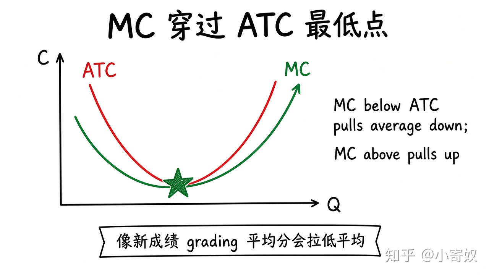

# 04｜平均成本与边际成本曲线

- 所属单元：Unit 06
- 建议用时：15 分钟
- 本节只解决：**为什么边际成本会穿过平均总成本的最低点？**
- 导航：[上一节](03_fixed_variable_costs.md) · [返回单元首页](README.md) · [下一节](05_economies_scale.md)

## 0～2 分钟：主动回忆

> 为什么边际成本会穿过平均总成本的最低点？

## 本节术语

| 中文术语 | English | 缩写 | 通俗解释 |
|---|---|---|---|
| 平均固定成本 | Average Fixed Cost | AFC | 固定成本除以产量。 |
| 平均可变成本 | Average Variable Cost | AVC | 可变成本除以产量。 |
| 平均总成本 | Average Total Cost | ATC | 总成本除以产量，ATC=AFC+AVC。 |
| 边际成本 | Marginal Cost | MC | 再增加一单位行动所带来的额外成本。 |

> 第一次出现记住「中文（English, 缩写）」；无公认缩写就写「无通用缩写」，不要自造。

## 2～9 分钟：核心内容

AFC=FC/Q（产量升则降）；AVC=VC/Q；ATC=TC/Q=AFC+AVC。边际成本（Marginal Cost, MC）是多生产一单位增加的 TC。

MC 低于 ATC 时把平均拉低；高于 ATC 时把平均拉高 → MC 穿过 ATC 最低点（像新成绩低于平均分会拉低平均）。DMP 常使 MC 在高产量上升；AFC 下降与 MC 上升共同形成 U 形 ATC。

## 9～12 分钟：最小例子

当前平均成本 80 元。下一单位 MC=60 → 平均下降；MC=100 → 平均上升。

## 12～14 分钟：你来做

Q=10 时 TC=800，Q=11 时 TC=870。算 Q=10 的 ATC 与第 11 单位 MC，判断会拉高还是拉低平均。

## 14～15 分钟：费曼复述

> AFC 随产量通常 ______；MC 低于 ATC 时平均成本 ______，高于 ATC 时平均成本 ______。

## 适用边界

曲线形状是简化。数字产品可能有高固定成本、低复制 MC，但容量、客服与获客仍会随规模变。

## 完成证据

- [ ] 能说出本节英文术语与缩写
- [ ] 完成最小例子
- [ ] 保留了自己的判断过程
- [ ] 一句话复述与疑问已写入[工作簿](../workbook.md)
