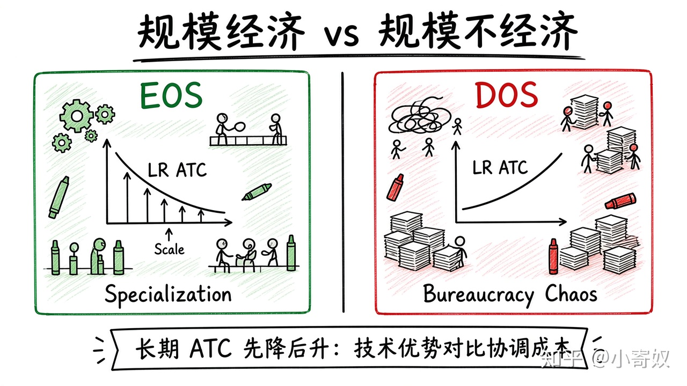

# 05｜长期平均成本与规模经济

- 所属单元：Unit 06
- 建议用时：15 分钟
- 本节只解决：**为什么规模扩大有时降低成本，有时却让组织变得更贵？**
- 导航：[上一节](04_average_marginal_cost.md) · [返回单元首页](README.md) · [下一节](06_perfect_competition_mr.md)

## 0～2 分钟：主动回忆

> 为什么规模扩大有时降低成本，有时却让组织变得更贵？

## 本节术语

| 中文术语 | English | 缩写 | 通俗解释 |
|---|---|---|---|
| 规模经济 | Economies of Scale | EOS | 长期平均总成本随产量增加而下降。 |
| 规模不经济 | Diseconomies of Scale | DOS | 长期平均总成本随产量增加而上升。 |
| 平均总成本 | Average Total Cost | ATC | 总成本除以产量，ATC=AFC+AVC。 |

> 第一次出现记住「中文（English, 缩写）」；无公认缩写就写「无通用缩写」，不要自造。

## 2～9 分钟：核心内容

规模经济（Economies of Scale, EOS）：长期 ATC 随产量扩大而下降（研发分摊、专业化、批量采购、基础设施复用）。

规模不经济（Diseconomies of Scale, DOS）：长期 ATC 随规模上升（沟通层级、审批、目标错位、管理复杂度）。长期平均成本可能先降、后平、再升。比较技术/采购优势是否超过协调与代理成本。

## 9～12 分钟：最小例子

自动驾驶基础模型研发成本高，部署到更多车型可分摊（EOS）；车型与团队过多后接口与验证激增，可能进入 DOS。

## 12～14 分钟：你来做

为一家车企列出三项 EOS 来源和三项 DOS 来源，并判断哪项最可能成为当前瓶颈。

## 14～15 分钟：费曼复述

> EOS 使长期 ATC 随规模 ______；DOS 使其 ______。最优规模取决于技术优势与 ______ 成本的比较。

## 适用边界

规模经济不自动证明垄断可持续。需求规模、进入壁垒、替代技术与组织能力同样关键。

## 完成证据

- [ ] 能说出本节英文术语与缩写
- [ ] 完成最小例子
- [ ] 保留了自己的判断过程
- [ ] 一句话复述与疑问已写入[工作簿](../workbook.md)
