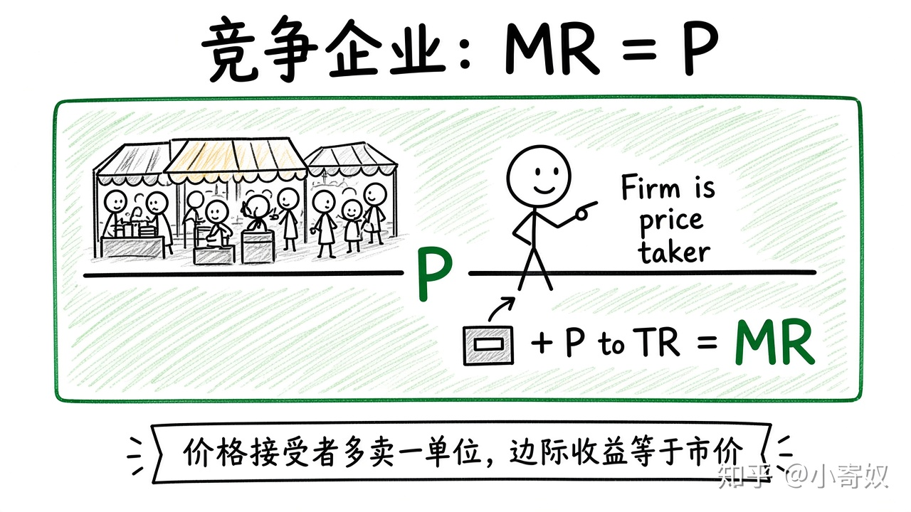

# 06｜完全竞争、价格接受者与边际收益

- 所属单元：Unit 06
- 建议用时：15 分钟
- 本节只解决：**为什么竞争企业多卖一单位时，边际收益等于市场价格？**
- 导航：[上一节](05_economies_scale.md) · [返回单元首页](README.md) · [下一节](07_profit_shutdown_exit.md)

## 0～2 分钟：主动回忆

> 为什么竞争企业多卖一单位时，边际收益等于市场价格？

## 本节术语

| 中文术语 | English | 缩写 | 通俗解释 |
|---|---|---|---|
| 完全竞争 | Perfect Competition | PC | 产品同质、买卖者众多、自由进入退出的理想市场结构。 |
| 价格接受者 | Price Taker | 无通用缩写 | 无法影响市场价格，只能接受既定价格的市场参与者。 |
| 边际收益（企业） | Marginal Revenue | MR | 企业多销售一单位产品所增加的总收益。 |
| 总收益 | Total Revenue | TR | 销售收入，等于价格乘以销量：TR=P×Q。 |

> 第一次出现记住「中文（English, 缩写）」；无公认缩写就写「无通用缩写」，不要自造。

## 2～9 分钟：核心内容

完全竞争（Perfect Competition, PC）假定产品同质、买卖者众多、信息较充分且可自由进入退出。单个企业是价格接受者（Price Taker）。

TR=P×Q。P 固定时，多卖一单位增加的总收益即边际收益（Marginal Revenue, MR）=P。这不表示利润总为正；仍要比较 MR 与 MC。PC 是基准模型。

## 9～12 分钟：最小例子

市价 80 元，从 100 件增到 101 件，TR 增 80 → MR=80。若 MC=70 值得生产；MC=90 则不值得。

## 12～14 分钟：你来做

市价 50 元，列出 Q=0、1、2、3 时 TR 并算每一单位 MR。说明为何不能随意把价格提到 60。

## 14～15 分钟：费曼复述

> 竞争企业是 ______，所以每多卖一单位的 MR 等于 ______；产量决策比较 ______ 与 MC。

## 适用边界

现实常有产品差异、合同与容量限制。PC 是基准，不是对所有行业的直接描述。

## 完成证据

- [ ] 能说出本节英文术语与缩写
- [ ] 完成最小例子
- [ ] 保留了自己的判断过程
- [ ] 一句话复述与疑问已写入[工作簿](../workbook.md)
