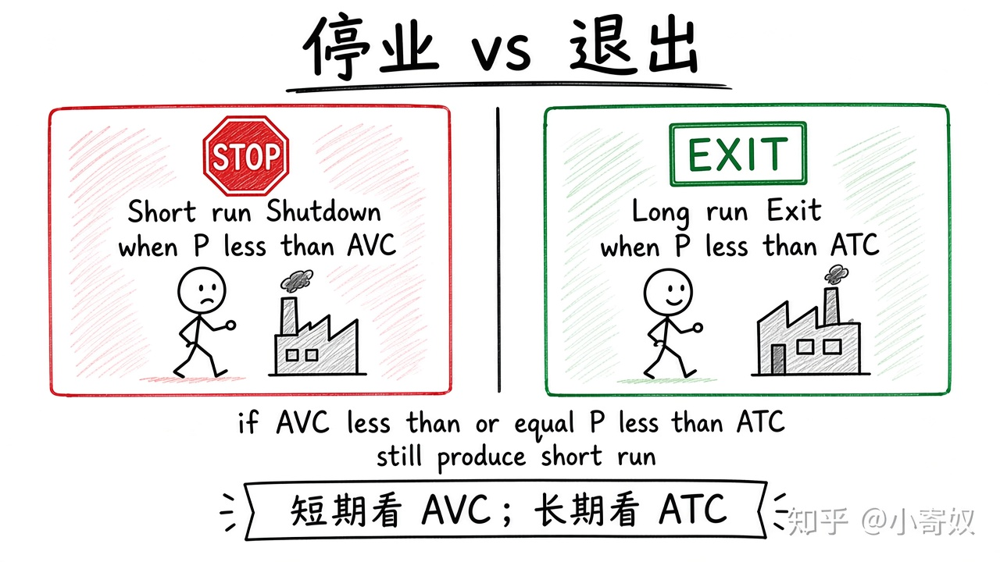

# 07｜利润最大化、停业与退出

- 所属单元：Unit 06
- 建议用时：15 分钟
- 本节只解决：**企业亏损时，为什么短期可能继续生产，长期却选择退出？**
- 导航：[上一节](06_perfect_competition_mr.md) · [返回单元首页](README.md) · [下一节](08_unit_review.md)

## 0～2 分钟：主动回忆

> 企业亏损时，为什么短期可能继续生产，长期却选择退出？

## 本节术语

| 中文术语 | English | 缩写 | 通俗解释 |
|---|---|---|---|
| 边际收益（企业） | Marginal Revenue | MR | 企业多销售一单位产品所增加的总收益。 |
| 边际成本 | Marginal Cost | MC | 再增加一单位行动所带来的额外成本。 |
| 平均可变成本 | Average Variable Cost | AVC | 可变成本除以产量。 |
| 平均总成本 | Average Total Cost | ATC | 总成本除以产量，ATC=AFC+AVC。 |
| 停业点 | Shutdown Point | 无通用缩写 | 短期价格低于平均可变成本时，企业通常停止生产。 |
| 退出 | Exit | 无通用缩写 | 企业在长期离开一个市场。 |

> 第一次出现记住「中文（English, 缩写）」；无公认缩写就写「无通用缩写」，不要自造。

## 2～9 分钟：核心内容

利润最大化产量满足 MR≈MC。短期 FC 已承担：只要 P≥AVC，收入就能覆盖 VC 并分担部分 FC，可能亏损仍继续。

短期停业：P<AVC。长期退出：P<ATC。停业是暂时产量为零；退出是长期离开并调整固定投入。

## 9～12 分钟：最小例子

P=80，AVC=60，ATC=100，MC=80。每单位亏 20，但覆盖 VC 并贡献 20 付 FC → 短期继续；长期不改善则退出。

## 12～14 分钟：你来做

判断：①P=70, AVC=50, ATC=90；②P=40, AVC=50, ATC=90；③长期 P=85, ATC=80。

## 14～15 分钟：费曼复述

> 短期生产看 P 是否覆盖 ______；长期留在市场看 P 是否覆盖 ______；最优产量满足 MR 约等于 ______。

## 适用边界

若停产与重启有额外成本、合同义务或战略价值，简单阈值需调整，但核心仍是比较可避免成本。

## 完成证据

- [ ] 能说出本节英文术语与缩写
- [ ] 完成最小例子
- [ ] 保留了自己的判断过程
- [ ] 一句话复述与疑问已写入[工作簿](../workbook.md)
