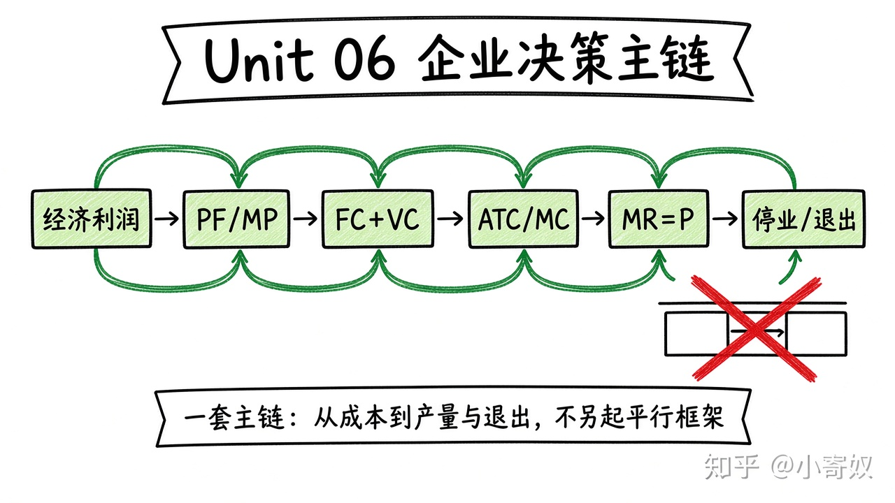

# 08｜单元复盘：企业为什么亏损仍生产

- 所属单元：Unit 06
- 建议用时：15 分钟
- 本节只解决：**能否从生产函数一路推到竞争企业的产量、停业与退出决策？**
- 导航：[上一节](07_profit_shutdown_exit.md) · [返回单元首页](README.md)

## 0～2 分钟：主动回忆

> 能否从生产函数一路推到竞争企业的产量、停业与退出决策？

## 本节术语（复用）

| 中文术语 | English | 缩写 |
|---|---|---|
| 经济利润 | Economic Profit | 无通用缩写 |
| 边际产量 | Marginal Product | MP |
| 平均总成本 | Average Total Cost | ATC |
| 停业点 | Shutdown Point | 无通用缩写 |

## 2～9 分钟：核心内容

闭卷回忆这一条主线（**一套流程，不要另起平行方案**）：



```text
经济利润（含隐性成本）
→ PF → MP 递减 → MC 上升
→ FC+VC → AFC/AVC/ATC
→ 竞争企业：P=MR → MR 与 MC 定产量
→ P 与 AVC 判短期停业；P 与 ATC 判长期退出
```

## 9～12 分钟：最小例子

账面盈利却因创始人时间与自有资本机会成本更高而经济亏损；短期仍生产，只要收入覆盖 VC 并分担 FC。

## 12～14 分钟：你来做

闭卷：①算经济利润；②算 MP；③算 AFC/AVC/ATC/MC；④判断生产、停业或退出；⑤一分钟讲「亏损为何仍生产」。

## 14～15 分钟：费曼复述

> 企业决策要把 ______ 成本计入利润，用 MR 与 MC 定产量，用 AVC 判断 ______，用 ATC 判断 ______。

## 适用边界

本单元假定企业接受市场价格。下一单元加入市场势力、产品差异和战略互动。

## 完成证据

- [ ] 能说出本节英文术语与缩写
- [ ] 完成最小例子
- [ ] 保留了自己的判断过程
- [ ] 一句话复述与疑问已写入[工作簿](../workbook.md)
