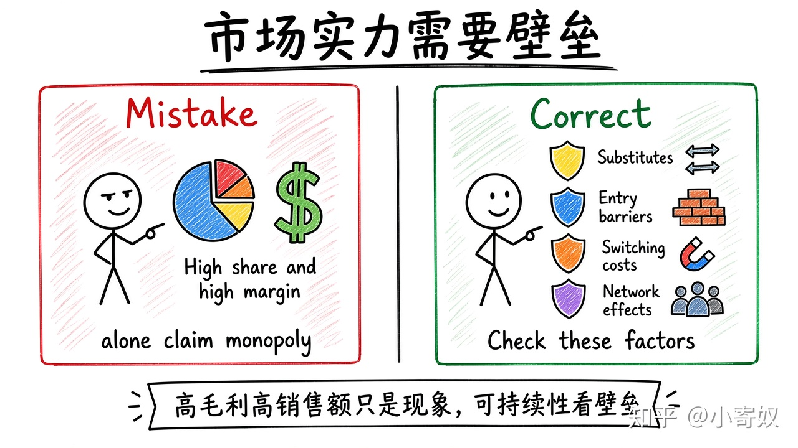

# 01｜垄断、市场势力与进入壁垒

- 所属单元：Unit 07
- 建议用时：15 分钟
- 本节只解决：**高毛利、高份额和高价格为什么还不足以证明可持续垄断？**
- 导航：[返回单元首页](README.md) · [下一节](02_monopoly_mr_mc.md)

## 0～2 分钟：主动回忆

> 高毛利、高份额和高价格为什么还不足以证明可持续垄断？

## 本节术语

| 中文术语 | English | 缩写 | 通俗解释 |
|---|---|---|---|
| 垄断 | Monopoly | 无通用缩写 | 某种产品只有一个卖方且缺乏近似替代品的市场结构。 |
| 市场势力 | Market Power | 无通用缩写 | 企业能够把价格维持在边际成本之上的能力。 |
| 自然垄断 | Natural Monopoly | 无通用缩写 | 一个企业供应整个市场的成本低于多个企业分担市场。 |

> 第一次出现记住「中文（English, 缩写）」；无公认缩写就写「无通用缩写」，不要自造。

## 2～9 分钟：核心内容

垄断（Monopoly，无通用缩写）是某产品只有一个卖方且缺乏近似替代品。市场势力（Market Power，无通用缩写）是把价格维持在边际成本之上的能力。

势力可能来自关键资源、许可、专利、网络效应、转换成本与规模经济。自然垄断（Natural Monopoly）是单企业服务全市场成本更低。高毛利、高份额只是现象；要查替代品、潜在进入、转换成本、技术变化、监管与利润持续时间。

## 9～12 分钟：最小例子

软件公司份额 70%、毛利高，但若可一键迁移且开源替代成熟，势力可能脆弱；数据网络效应与高迁移成本则可能更强。

## 12～14 分钟：你来做

选一家熟悉公司，列出份额、替代品、进入壁垒、转换成本、技术替代风险，只给「强/中/弱」暂定判断。

## 14～15 分钟：费曼复述

> 市场势力是企业将价格维持在 ______ 之上的能力；判断持续性要检查 ______、进入壁垒和转换成本。

## 适用边界

市场边界定义会改变份额。「智能汽车」定义宽或窄，垄断判断可能完全不同。

## 完成证据

- [ ] 能说出本节英文术语与缩写
- [ ] 完成最小例子
- [ ] 保留了自己的判断过程
- [ ] 一句话复述与疑问已写入[工作簿](../workbook.md)
