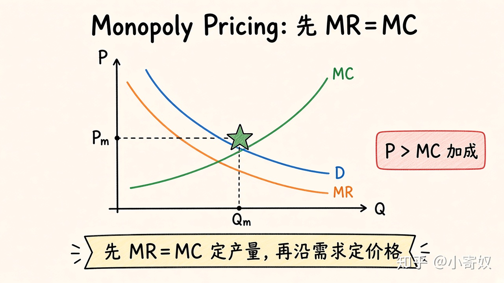

# 02｜垄断企业的边际收益与产量

- 所属单元：Unit 07
- 建议用时：15 分钟
- 本节只解决：**垄断企业为什么不能像竞争企业那样直接令价格等于边际成本？**
- 导航：[上一节](01_monopoly_market_power.md) · [返回单元首页](README.md) · [下一节](03_price_discrimination.md)

## 0～2 分钟：主动回忆

> 垄断企业为什么不能像竞争企业那样直接令价格等于边际成本？

## 本节术语

| 中文术语 | English | 缩写 | 通俗解释 |
|---|---|---|---|
| 边际收益（企业） | Marginal Revenue | MR | 企业多销售一单位产品所增加的总收益。 |
| 边际成本 | Marginal Cost | MC | 再增加一单位行动所带来的额外成本。 |
| 加成 | Markup | 无通用缩写 | 价格高于边际成本的部分。 |
| 无谓损失 | Deadweight Loss | DWL | 未实现的互利交易所造成的总剩余损失。 |

> 第一次出现记住「中文（English, 缩写）」；无公认缩写就写「无通用缩写」，不要自造。

## 2～9 分钟：核心内容

垄断者面对向下倾斜的需求。多卖一单位通常需降价，且降价可能作用于原有销量 → MR 低于 P。

利润最大化：先选 MR=MC 的数量，再从需求曲线找价格。结果通常 P>MC（加成 Markup），产量更低、价格更高，并产生无谓损失（DWL）。顺序是「先 MR=MC 定数量，再需求定价格」，勿把需求与 MR 混为一条。

## 9～12 分钟：最小例子

第 100 件价 100 元；要卖第 101 件须把全部 101 件降到 99 元。新增一件收入 99，但原 100 件各少 1 → 总 MR 远低于价格。

## 12～14 分钟：你来做

用文字说明需求、MR、MC 与垄断价格的关系，并解释为何垄断者不会无限提价。

## 14～15 分钟：费曼复述

> 垄断先用 ______=______ 决定数量，再从 ______ 曲线确定价格，因此通常 P ______ MC。

## 适用边界

现实可能多产品定价、动态竞争与不确定需求；静态单产品模型是理解加成的第一步。

## 完成证据

- [ ] 能说出本节英文术语与缩写
- [ ] 完成最小例子
- [ ] 保留了自己的判断过程
- [ ] 一句话复述与疑问已写入[工作簿](../workbook.md)
