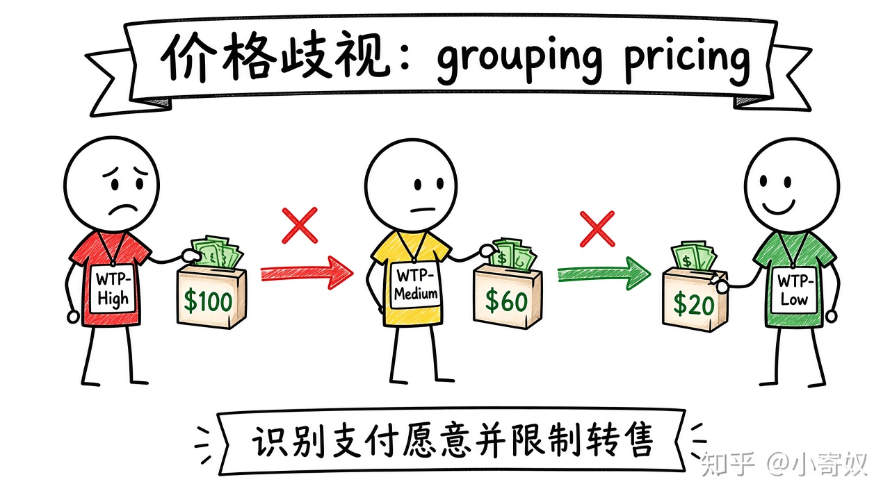

# 03｜价格歧视与消费者分组

- 所属单元：Unit 07
- 建议用时：15 分钟
- 本节只解决：**为什么同一产品向不同消费者收费不同，可能提高利润甚至扩大交易？**
- 导航：[上一节](02_monopoly_mr_mc.md) · [返回单元首页](README.md) · [下一节](04_monopolistic_competition.md)

## 0～2 分钟：主动回忆

> 为什么同一产品向不同消费者收费不同，可能提高利润甚至扩大交易？

## 本节术语

| 中文术语 | English | 缩写 | 通俗解释 |
|---|---|---|---|
| 价格歧视 | Price Discrimination | PD | 向不同消费者对相同或相近产品收取不同价格，且差异并非完全来自成本。 |
| 支付意愿 | Willingness to Pay | WTP | 消费者购买某单位商品愿意支付的最高金额。 |
| 消费者剩余 | Consumer Surplus | CS | 支付意愿减去实际支付价格。 |

> 第一次出现记住「中文（English, 缩写）」；无公认缩写就写「无通用缩写」，不要自造。

## 2～9 分钟：核心内容

价格歧视（Price Discrimination, PD）是对相同或相近产品收不同价，且差异不完全来自成本。需要市场势力、识别不同支付意愿（WTP），并阻止低价购买者转售。

完全 PD 尝试向每人收接近 WTP，把 CS 转为企业收益，并可能扩大到所有 WTP≥MC 的交易。现实更常见版本、数量、时间与人群定价。PD ≠ 自动违法；要区分成本差异、促销、个体定价与受保护群体歧视。

## 9～12 分钟：最小例子

软件基础版/专业版/企业版：功能确有成本差异，也用于让高 WTP 客户自我选择更高价格。

## 12～14 分钟：你来做

分析机票、会员订阅或新能源车配置：怎样识别 WTP？如何防转售？谁获得或失去 CS？

## 14～15 分钟：费曼复述

> PD 需要市场势力、识别 ______ 并限制 ______；它通常把部分 ______ 转给企业。

## 适用边界

数据驱动个体定价可能引发隐私、公平与监管问题；利润效果与社会福利效果必须分开。

## 完成证据

- [ ] 能说出本节英文术语与缩写
- [ ] 完成最小例子
- [ ] 保留了自己的判断过程
- [ ] 一句话复述与疑问已写入[工作簿](../workbook.md)
