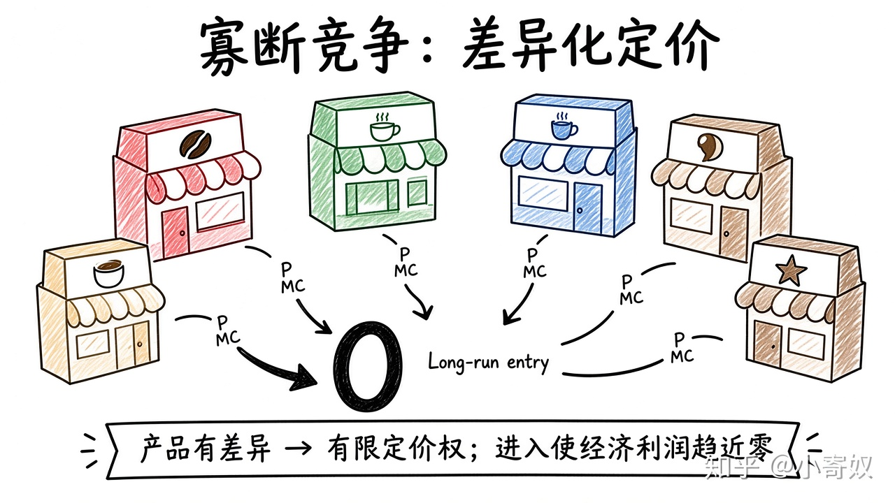

# 04｜垄断竞争与产品差异化

- 所属单元：Unit 07
- 建议用时：15 分钟
- 本节只解决：**为什么市场里企业很多，仍然可以有一定定价权？**
- 导航：[上一节](03_price_discrimination.md) · [返回单元首页](README.md) · [下一节](05_oligopoly_interdependence.md)

## 0～2 分钟：主动回忆

> 为什么市场里企业很多，仍然可以有一定定价权？

## 本节术语

| 中文术语 | English | 缩写 | 通俗解释 |
|---|---|---|---|
| 垄断竞争 | Monopolistic Competition | MCmp | 企业众多、产品有差异、可以自由进入退出的市场结构。 |
| 产品差异化 | Product Differentiation | 无通用缩写 | 企业通过功能、质量、品牌或服务使产品与竞争者不同。 |
| 加成 | Markup | 无通用缩写 | 价格高于边际成本的部分。 |
| 经济利润 | Economic Profit | 无通用缩写 | 总收益减去显性成本和隐性成本。 |

> 第一次出现记住「中文（English, 缩写）」；无公认缩写就写「无通用缩写」，不要自造。

## 2～9 分钟：核心内容

垄断竞争（Monopolistic Competition, MCmp）：企业众多、产品差异化、自由进入退出。因品牌/地点/功能差异面对向下倾斜需求，有有限加成；替代品多，势力有限。

短期可能正经济利润；长期进入分走需求，经济利润趋近零，但仍常有 P>MC 与剩余产能。广告可能提供信息，也可能只塑造偏好。

## 9～12 分钟：最小例子

咖啡店众多但位置、口味不同：可在一定范围定价，却不能忽视附近店。新店进入会压缩需求与利润。

## 12～14 分钟：你来做

用智能汽车品牌举例：三种产品差异化、两个近似替代品、一个进入后的长期影响。

## 14～15 分钟：费曼复述

> MCmp 中企业很多但产品 ______，所以有有限市场势力；长期进入使经济利润趋近 ______。

## 适用边界

若进入壁垒高或网络效应强，市场可能更接近寡头或垄断，不能机械归入垄断竞争。

## 完成证据

- [ ] 能说出本节英文术语与缩写
- [ ] 完成最小例子
- [ ] 保留了自己的判断过程
- [ ] 一句话复述与疑问已写入[工作簿](../workbook.md)
