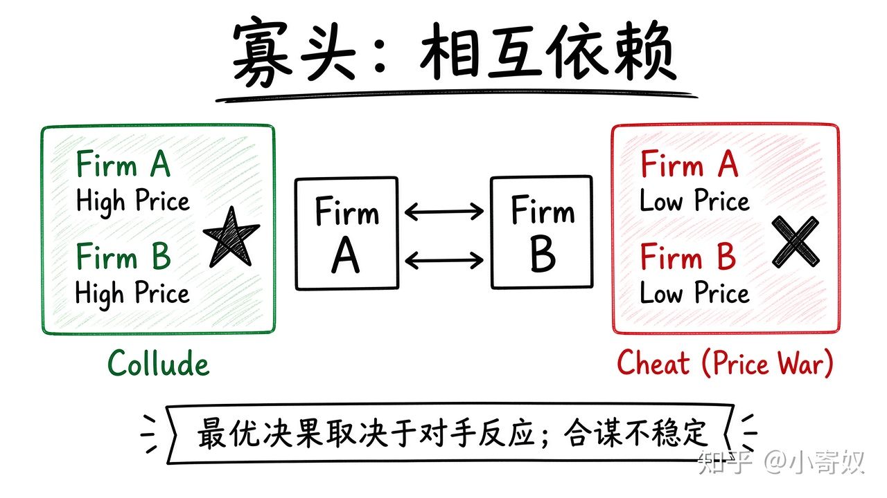

# 05｜寡头与战略相互依赖

- 所属单元：Unit 07
- 建议用时：15 分钟
- 本节只解决：**为什么少数企业的最优决策取决于竞争者会怎样反应？**
- 导航：[上一节](04_monopolistic_competition.md) · [返回单元首页](README.md) · [下一节](06_game_theory_nash.md)

## 0～2 分钟：主动回忆

> 为什么少数企业的最优决策取决于竞争者会怎样反应？

## 本节术语

| 中文术语 | English | 缩写 | 通俗解释 |
|---|---|---|---|
| 寡头 | Oligopoly | 无通用缩写 | 少数企业占据大部分市场、相互决策依赖明显的市场结构。 |
| 市场势力 | Market Power | 无通用缩写 | 企业能够把价格维持在边际成本之上的能力。 |
| 合谋 | Collusion | 无通用缩写 | 企业协调价格或产量以提高共同利润。 |
| 卡特尔 | Cartel | 无通用缩写 | 采取联合行动的一组企业。 |

> 第一次出现记住「中文（English, 缩写）」；无公认缩写就写「无通用缩写」，不要自造。

## 2～9 分钟：核心内容

寡头（Oligopoly，无通用缩写）由少数企业占据大部分市场。价格、产量、研发与广告决策会互相影响 → 战略相互依赖。

共同减产提价可接近垄断利润，称合谋（Collusion）；正式联合称卡特尔（Cartel）。但每家都有偷偷降价/扩产的激励，合谋不稳定。企业少、互动重复、需求稳定、行为易观察时，协调可能更容易。

## 9～12 分钟：最小例子

两家约定高价，但一家单独降价可抢客户。若双方都担心对方降价，可能陷入价格战，利润低于共同维持高价。

## 12～14 分钟：你来做

选汽车、通信或云服务：写一个企业决策与竞争者两种反应，说明为何不能只做静态成本分析。

## 14～15 分钟：费曼复述

> 寡头的核心是 ______；合谋可提高共同利润，但每家企业都有 ______ 的激励。

## 适用边界

价格相近不自动证明合谋，也可能是成本相近、公开信息或竞争均衡，需要更强证据。

## 完成证据

- [ ] 能说出本节英文术语与缩写
- [ ] 完成最小例子
- [ ] 保留了自己的判断过程
- [ ] 一句话复述与疑问已写入[工作簿](../workbook.md)
