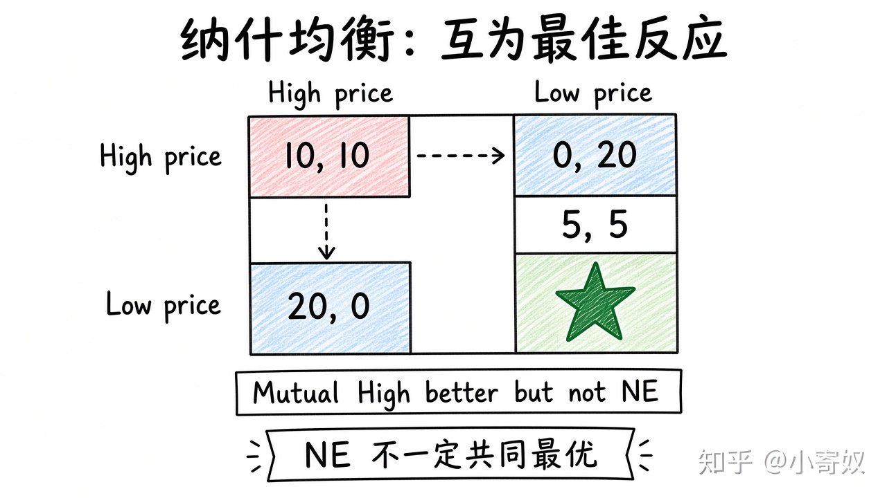

# 06｜博弈论、占优策略与纳什均衡

- 所属单元：Unit 07
- 建议用时：15 分钟
- 本节只解决：**怎样在竞争者策略会影响结果时系统分析选择？**
- 导航：[上一节](05_oligopoly_interdependence.md) · [返回单元首页](README.md) · [下一节](07_prisoners_dilemma_repeated.md)

## 0～2 分钟：主动回忆

> 怎样在竞争者策略会影响结果时系统分析选择？

## 本节术语

| 中文术语 | English | 缩写 | 通俗解释 |
|---|---|---|---|
| 博弈论 | Game Theory | GT | 研究相互依赖的决策者如何选择策略的工具。 |
| 收益矩阵 | Payoff Matrix | 无通用缩写 | 列出不同策略组合下各参与者收益的表格。 |
| 占优策略 | Dominant Strategy | DS | 无论其他参与者怎样选择，都给自己更高收益的策略。 |
| 纳什均衡 | Nash Equilibrium | NE | 每个人在其他人策略给定时都没有单方面改变的动力。 |

> 第一次出现记住「中文（English, 缩写）」；无公认缩写就写「无通用缩写」，不要自造。

## 2～9 分钟：核心内容

博弈论（Game Theory, GT）研究相互依赖决策。收益矩阵列出各策略组合收益。

占优策略（Dominant Strategy, DS）：对方任何选择下都给自己更高收益。纳什均衡（Nash Equilibrium, NE）：每人在他人策略给定时都无单方面改变动力。NE 不一定使共同收益最大，也不一定唯一。步骤：参与者 → 策略 → 收益 → 最佳反应 → 相互最佳反应交点。

## 9～12 分钟：最小例子

两企业可高价或低价。若无论对方如何，低价都更好 → 低价是 DS；双方低价成 NE，即使双方高价共同收益更高。

## 12～14 分钟：你来做

画 2×2 收益矩阵：两家企业「高研发/低研发」。标出每方最佳反应和可能 NE。

## 14～15 分钟：费曼复述

> GT 先定义参与者、______ 和收益；DS 不依赖对方选择；NE 是双方策略互为 ______。

## 适用边界

收益数值需含长期、声誉与风险。遗漏重要收益会使矩阵误导。

## 完成证据

- [ ] 能说出本节英文术语与缩写
- [ ] 完成最小例子
- [ ] 保留了自己的判断过程
- [ ] 一句话复述与疑问已写入[工作簿](../workbook.md)
