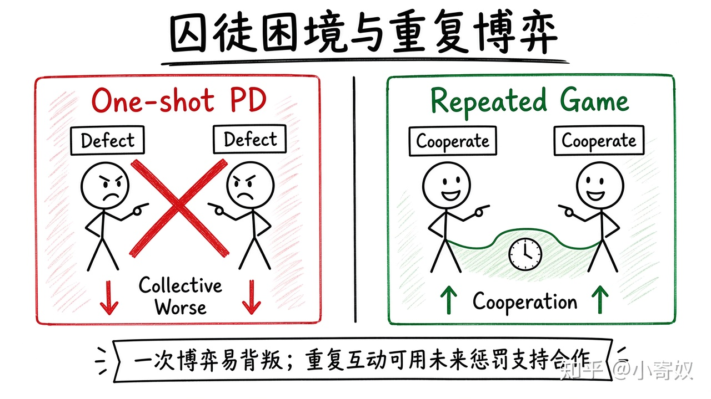

# 07｜囚徒困境、重复博弈与合作

- 所属单元：Unit 07
- 建议用时：15 分钟
- 本节只解决：**为什么个体理性会产生集体较差结果，长期互动又怎样改变它？**
- 导航：[上一节](06_game_theory_nash.md) · [返回单元首页](README.md) · [下一节](08_unit_review.md)

## 0～2 分钟：主动回忆

> 为什么个体理性会产生集体较差结果，长期互动又怎样改变它？

## 本节术语

| 中文术语 | English | 缩写 | 通俗解释 |
|---|---|---|---|
| 囚徒困境 | Prisoners' Dilemma | PrD | 个体理性策略组合导致集体较差结果的经典博弈。PrD 为本课程避免与价格歧视 PD 混淆采用。 |
| 重复博弈 | Repeated Game | RG | 相同参与者多次互动的博弈。 |
| 合谋 | Collusion | 无通用缩写 | 企业协调价格或产量以提高共同利润。 |
| 纳什均衡 | Nash Equilibrium | NE | 每个人在其他人策略给定时都没有单方面改变的动力。 |

> 第一次出现记住「中文（English, 缩写）」；无公认缩写就写「无通用缩写」，不要自造。

## 2～9 分钟：核心内容

囚徒困境（Prisoners' Dilemma, PrD）：各选占优策略，却导致双方都比合作更差。可解释价格战、军备竞赛与公共资源过度使用。

重复博弈（Repeated Game, RG）让今天行为影响未来回报。若重视未来、能观察违约并可信惩罚，合作可能更稳定。但寡头维持高价合作可能损害消费者并违反竞争法——须区分社会有益协作与限制竞争的合谋。

## 9～12 分钟：最小例子

两家车企每轮可降价抢份额。一次博弈中都降价可能是 NE；若长期竞争，单次偷袭触发报复，维持克制的激励增强。

## 12～14 分钟：你来做

把「团队共享测试资源」或「车企价格战」写成 PrD：个体最优、共同最优、违约收益与未来惩罚。

## 14～15 分钟：费曼复述

> PrD 说明个体理性可能导致 ______；RG 通过未来收益、观察和 ______ 改变合作激励。

## 适用边界

长期重复不保证合作。参与者更替、信息噪声、短期压力和无法惩罚都会破坏合作。

## 完成证据

- [ ] 能说出本节英文术语与缩写
- [ ] 完成最小例子
- [ ] 保留了自己的判断过程
- [ ] 一句话复述与疑问已写入[工作簿](../workbook.md)
