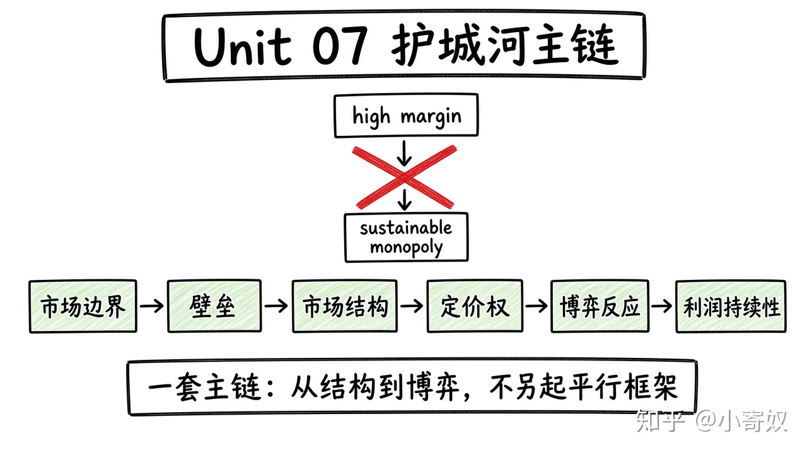

# 08｜单元复盘：从市场结构到护城河

- 所属单元：Unit 07
- 建议用时：15 分钟
- 本节只解决：**能否用市场结构和博弈论判断一家公司的竞争优势是否可持续？**
- 导航：[上一节](07_prisoners_dilemma_repeated.md) · [返回单元首页](README.md)

## 0～2 分钟：主动回忆

> 能否用市场结构和博弈论判断一家公司的竞争优势是否可持续？

## 本节术语（复用）

| 中文术语 | English | 缩写 |
|---|---|---|
| 市场势力 | Market Power | 无通用缩写 |
| 垄断竞争 | Monopolistic Competition | MCmp |
| 寡头 | Oligopoly | 无通用缩写 |
| 纳什均衡 | Nash Equilibrium | NE |

## 2～9 分钟：核心内容

闭卷回忆这一条主线（**一套流程，不要另起平行方案**）：



```text
市场边界 → 替代品 → 企业数量
→ 进入壁垒 / 转换成本 / 网络效应
→ 市场结构 → 定价权
→ 竞争者最佳反应 → NE 或价格战
→ 利润持续性
```

不要从高毛利直接跳到「可持续垄断」，更不能从好公司直接跳到「股票值得买」。

## 9～12 分钟：最小例子

平台份额高但用户多归属、转换成本低，网络效应可能弱；竞争者补贴可快速抢用户 → 当前高利润不稳定。

## 12～14 分钟：你来做

闭卷分析熟悉行业：定义市场、列替代品与壁垒、判断结构、画 2×2 博弈、写一个 NE、说明对利润持续性的影响。

## 14～15 分钟：费曼复述

> 可持续市场势力要由 ______、进入壁垒和战略反应支持；NE 描述 ______，但不一定社会最优。

## 适用边界

市场结构只解释经营机制。投资结论还需财务质量、资本配置、估值和宏观风险。

## 完成证据

- [ ] 能说出本节英文术语与缩写
- [ ] 完成最小例子
- [ ] 保留了自己的判断过程
- [ ] 一句话复述与疑问已写入[工作簿](../workbook.md)
