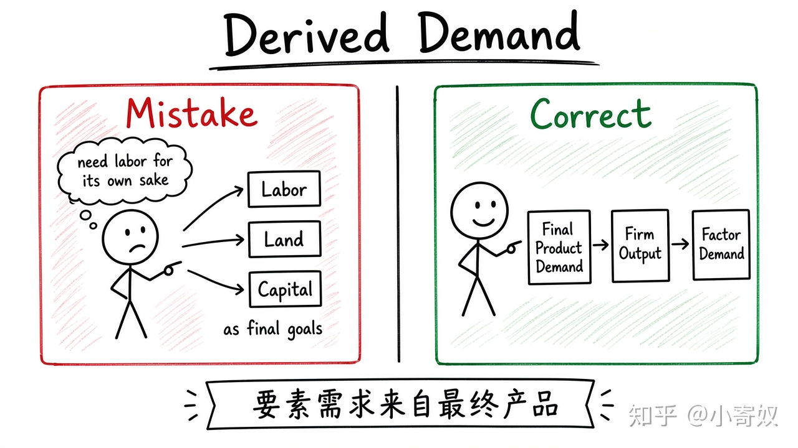

# 01｜生产要素市场与派生需求

- 所属单元：Unit 08
- 建议用时：15 分钟
- 本节只解决：**企业为什么需要劳动、土地和资本，它们的需求从哪里来？**
- 导航：[返回单元首页](README.md) · [下一节](02_vmp_mrp_labor_demand.md)

## 0～2 分钟：主动回忆

先写一句你目前的判断（可以是「不知道」）：

> 企业为什么需要劳动、土地和资本，它们的需求从哪里来？

## 本节术语

| 中文术语 | English | 缩写 | 通俗解释 |
|---|---|---|---|
| 生产要素 | Factors of Production | 无通用缩写 | 劳动、土地、资本等用于生产商品与服务的投入。 |
| 派生需求 | Derived Demand | 无通用缩写 | 对生产要素的需求来自消费者对最终产品的需求。 |
| 劳动—闲暇选择 | Labor–Leisure Choice | 无通用缩写 | 个人在工作收入与闲暇之间进行的选择。 |

> 第一次出现记住「中文（English, 缩写）」；无公认缩写就写「无通用缩写」，不要自造。

## 2～9 分钟：核心内容

生产要素（Factors of Production，无通用缩写）是生产所需投入：劳动、土地、资本。企业对要素的需求不是最终目的，而来自消费者对最终产品的需求，因此称派生需求（Derived Demand，无通用缩写）。

最终产品需求上升，相关工程师、算力与场地需求往往上升；产品需求下降时，即使技能不变，要素需求也可能下降。

劳动市场一边是企业的劳动需求，另一边是个人的劳动—闲暇选择（Labor–Leisure Choice，无通用缩写）。固定顺序即可：最终产品 → 产量 → 要素需求 → 劳动供给。

## 9～12 分钟：最小例子

矿山无人驾驶需求增长，提高软件与安全验证价值，企业对定位、感知与规划工程师的派生需求上升。

## 12～14 分钟：你来做

选一种最终产品，沿链条写出：消费者需求变化 → 企业产量 → 三种要素需求。指出哪一步可能被技术替代改变。

## 14～15 分钟：费曼复述

> 要素需求是 ______ 需求，因为它来自对 ______ 的需求；劳动市场连接企业需求与个人的 ______ 选择。

## 适用边界

技术既可能替代劳动，也可能提高某类劳动的生产率并增加其需求，方向取决于互补还是替代。

## 完成证据

- [ ] 能说出本节英文术语与缩写
- [ ] 完成最小例子
- [ ] 保留了自己的判断过程
- [ ] 一句话复述与疑问已写入[工作簿](../workbook.md)
