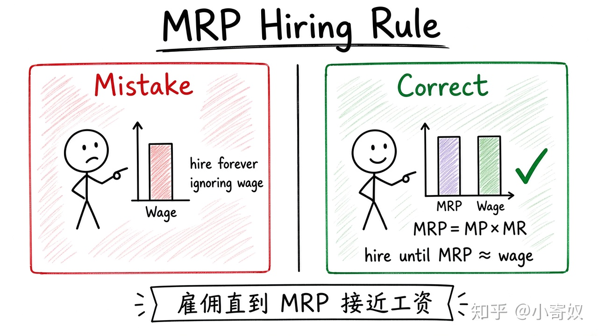

# 02｜边际产量价值与劳动需求

- 所属单元：Unit 08
- 建议用时：15 分钟
- 本节只解决：**企业为什么会雇人直到新增员工创造的收益接近工资？**
- 导航：[上一节](01_factor_markets_derived_demand.md) · [返回单元首页](README.md) · [下一节](03_labor_supply_equilibrium.md)

## 0～2 分钟：主动回忆

> 企业为什么会雇人直到新增员工创造的收益接近工资？

## 本节术语

| 中文术语 | English | 缩写 | 通俗解释 |
|---|---|---|---|
| 边际产量价值 | Value of Marginal Product | VMP | 边际产量乘以产品价格：VMP=MP×P。 |
| 边际收益产量 | Marginal Revenue Product | MRP | 增加一单位投入带来的边际收益：MRP=MP×MR。 |
| 边际产量 | Marginal Product | MP | 增加一单位投入带来的额外产出。 |

## 2～9 分钟：核心内容

边际产量价值（Value of Marginal Product, VMP）= MP × P。竞争产品市场中 P=MR，故 VMP 等于边际收益产量（Marginal Revenue Product, MRP）：

$$
MRP=MP\times MR
$$

利润最大化企业增加劳动，直到新增劳动的 MRP 接近工资。MP 递减使劳动需求向下倾斜；产品价格、技术与其他投入变化会移动需求。

## 9～12 分钟：最小例子

新增工程师每月使可售项目增加 0.5 个，每项目边际收益 20 万元，则 MRP=10 万元/月。综合月成本 8 万则雇佣有利；12 万则不利。

## 12～14 分钟：你来做

工人每日 MP 依次为 10、8、6 件，产品价格 50 元。算各人 VMP；日工资 350 元时雇到第几人？

## 14～15 分钟：费曼复述

> MRP=______×______；企业雇佣直到新增劳动的 MRP 接近 ______。

## 适用边界

工资还含招聘、培训与福利；团队产出难归因到个人时，MRP 只能近似估计。

## 完成证据

- [ ] 能说出本节英文术语与缩写
- [ ] 完成最小例子
- [ ] 保留了自己的判断过程
- [ ] 一句话复述与疑问已写入[工作簿](../workbook.md)
