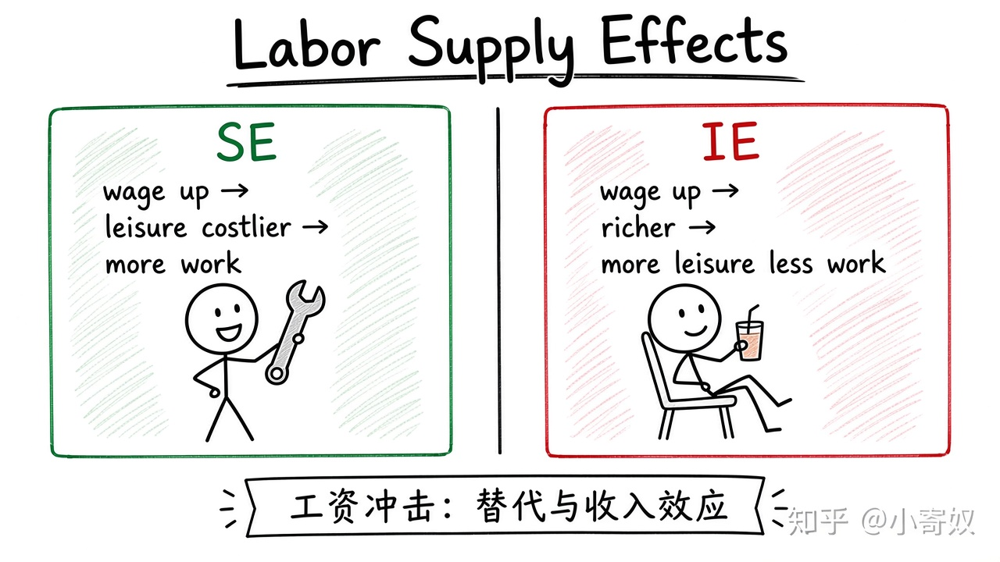

# 03｜劳动供给、工资与市场均衡

- 所属单元：Unit 08
- 建议用时：15 分钟
- 本节只解决：**工资上升时，劳动供给为什么不一定永远增加？**
- 导航：[上一节](02_vmp_mrp_labor_demand.md) · [返回单元首页](README.md) · [下一节](04_wage_differences.md)

## 0～2 分钟：主动回忆

> 工资上升时，劳动供给为什么不一定永远增加？

## 本节术语

| 中文术语 | English | 缩写 | 通俗解释 |
|---|---|---|---|
| 劳动—闲暇选择 | Labor–Leisure Choice | 无通用缩写 | 个人在工作收入与闲暇之间进行的选择。 |
| 均衡 | Equilibrium | Eq. | 买方计划购买量与卖方计划出售量相等的状态。 |
| 人力资本 | Human Capital | HC | 通过教育、经验和训练积累的生产能力。 |

## 2～9 分钟：核心内容

工资上升使闲暇更昂贵，可能促使人多工作（替代效应）；收入提高后也可能购买更多闲暇、少工作（收入效应）。市场工资由劳动需求与供给共同决定。

人力资本（Human Capital, HC）提高 MRP，通常推高该类劳动需求与工资。

固定分析顺序：需求/供给冲击 → 工资与就业 → 个人层面的 SE 与 IE。

## 9～12 分钟：最小例子

AI 技能需求右移、短期供给有限 → 工资上升；长期更多人培训转岗，供给增加，工资压力可能缓和。

## 12～14 分钟：你来做

分析「某地区大量高校扩招软件专业」对短期与长期供给、工资与就业的影响，并写一种需求变化的替代情形。

## 14～15 分钟：费曼复述

> 工资由劳动 ______ 与 ______ 决定；工资上涨对个人劳动供给同时有替代效应和 ______ 效应。

## 适用边界

劳动不是同质商品。技能、地点、工作条件与匹配质量会形成多个细分市场。

## 完成证据

- [ ] 能说出本节英文术语与缩写
- [ ] 完成最小例子
- [ ] 保留了自己的判断过程
- [ ] 一句话复述与疑问已写入[工作簿](../workbook.md)
