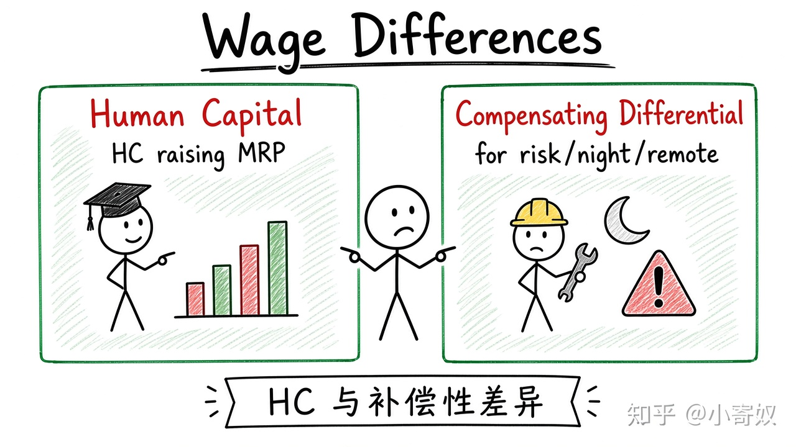

# 04｜工资差异：人力资本与补偿性差异

- 所属单元：Unit 08
- 建议用时：15 分钟
- 本节只解决：**为什么不同工作和不同劳动者的工资会长期不同？**
- 导航：[上一节](03_labor_supply_equilibrium.md) · [返回单元首页](README.md) · [下一节](05_discrimination_measurement.md)

## 0～2 分钟：主动回忆

> 为什么不同工作和不同劳动者的工资会长期不同？

## 本节术语

| 中文术语 | English | 缩写 | 通俗解释 |
|---|---|---|---|
| 人力资本 | Human Capital | HC | 通过教育、经验和训练积累的生产能力。 |
| 补偿性工资差异 | Compensating Differential | 无通用缩写 | 为补偿工作不愉快或风险而出现的工资差异。 |
| 边际收益产量 | Marginal Revenue Product | MRP | 增加一单位投入带来的边际收益：MRP=MP×MR。 |

## 2～9 分钟：核心内容

工资差异可能来自生产率、人力资本（HC）、工作条件、地点、风险、稀缺技能与暂时供需失衡。

补偿性工资差异（Compensating Differential，无通用缩写）是对危险、夜班或偏远地点的额外补偿。HC 通过提高 MRP 也会提高工资。

高现金工资不一定表示净福利更高；低现金工资可能搭配培训或灵活性。比较时看完整报酬与完整成本。

## 9～12 分钟：最小例子

偏远矿区算法岗工资高，可能既反映技能稀缺，也包含对地点、轮班与安全风险的补偿——不能全部归因于个人能力。

## 12～14 分钟：你来做

选两个工资差异明显的岗位，分别列出 HC、工作条件、供需与非现金福利解释，并指出仍缺什么证据。

## 14～15 分钟：费曼复述

> 工资差异可能反映生产率和 ______，也可能是对不利工作条件的 ______。

## 适用边界

学历与工资相关不自动证明全部由教育提升生产率；能力选择与家庭背景也可能影响。

## 完成证据

- [ ] 能说出本节英文术语与缩写
- [ ] 完成最小例子
- [ ] 保留了自己的判断过程
- [ ] 一句话复述与疑问已写入[工作簿](../workbook.md)
