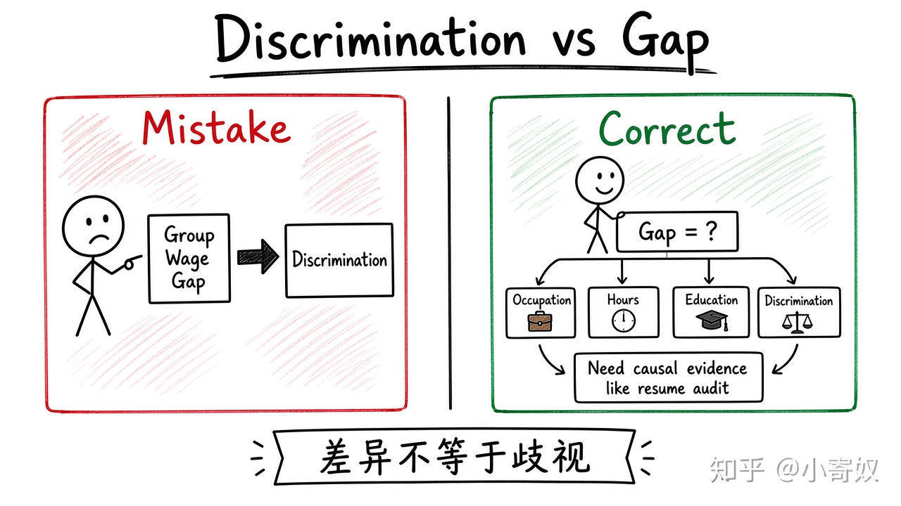

# 05｜歧视、差异与因果识别

- 所属单元：Unit 08
- 建议用时：15 分钟
- 本节只解决：**观察到群体工资差异时，怎样避免过快归因？**
- 导航：[上一节](04_wage_differences.md) · [返回单元首页](README.md) · [下一节](06_lorenz_gini.md)

## 0～2 分钟：主动回忆

> 观察到群体工资差异时，怎样避免过快归因？

## 本节术语

| 中文术语 | English | 缩写 | 通俗解释 |
|---|---|---|---|
| 歧视 | Discrimination | 无通用缩写 | 基于与生产率无关的身份特征给予不同待遇。 |
| 相关性 | Correlation | Corr. | 两个变量共同变化，但不自动证明一个导致另一个。 |
| 因果关系 | Causality | 无通用缩写 | 一个变量的变化真正导致另一个变量发生变化。 |

## 2～9 分钟：核心内容

歧视（Discrimination，无通用缩写）指基于与生产率无关的身份特征给予不同待遇。群体平均工资差异可能来自职业、经验、工时、地区与教育，也可能包含歧视。

控制可观察变量后差距仍在，是线索但不自动等于歧视（遗漏变量）；把由歧视造成的职业分流当作控制变量，又可能低估歧视。

更可信证据：匹配简历实验、审计研究、制度变化前后比较、岗位内同等表现比较。

## 9～12 分钟：最小例子

向同一岗位投递内容相同、只改姓名特征的简历，回访率差异能更直接识别招聘阶段待遇差异，但仍只覆盖特定环节与样本。

## 12～14 分钟：你来做

为「某群体平均工资更低」列出三个非歧视解释、两种歧视机制和一种识别设计。

## 14～15 分钟：费曼复述

> 群体差异是 ______，不自动证明 ______；判断歧视要比较生产率相近者并建立可信 ______。

## 适用边界

统计控制不能替代制度与历史分析；歧视可能影响教育、职业选择与晋升全过程。

## 完成证据

- [ ] 能说出本节英文术语与缩写
- [ ] 完成最小例子
- [ ] 保留了自己的判断过程
- [ ] 一句话复述与疑问已写入[工作簿](../workbook.md)
