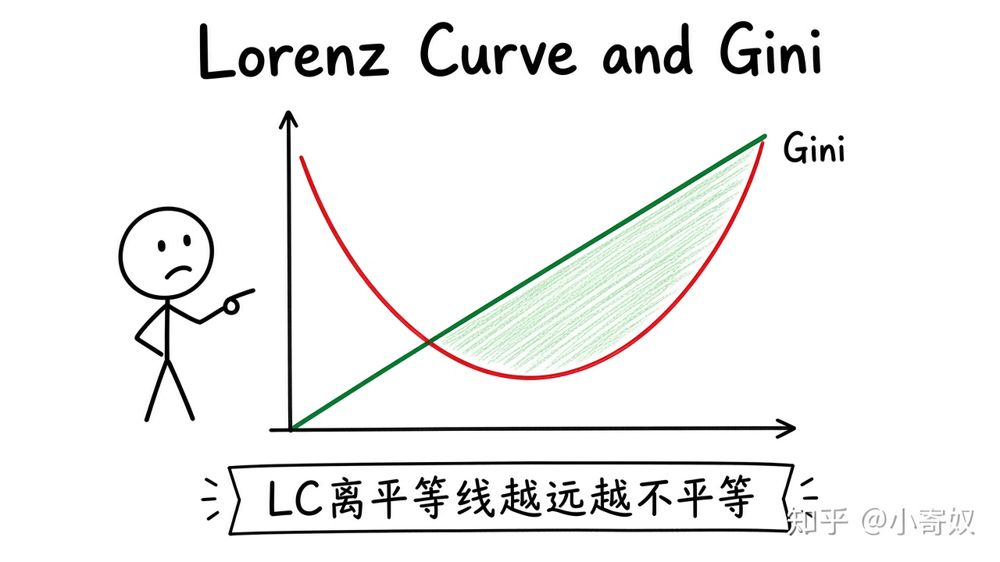

# 06｜收入分配、洛伦兹曲线与基尼系数

- 所属单元：Unit 08
- 建议用时：15 分钟
- 本节只解决：**怎样用图形和指标描述收入或财富不平等？**
- 导航：[上一节](05_discrimination_measurement.md) · [返回单元首页](README.md) · [下一节](07_poverty_redistribution.md)

## 0～2 分钟：主动回忆

> 怎样用图形和指标描述收入或财富不平等？

## 本节术语

| 中文术语 | English | 缩写 | 通俗解释 |
|---|---|---|---|
| 洛伦兹曲线 | Lorenz Curve | LC | 表示累计人口与累计收入或财富份额关系的曲线。 |
| 基尼系数 | Gini Coefficient | Gini | 衡量分配不平等程度的指标，通常在 0 到 1 之间。 |
| 公平 | Equity | 无通用缩写 | 经济成果如何在不同主体之间分配的价值问题。 |

## 2～9 分钟：核心内容

洛伦兹曲线（Lorenz Curve, LC）横轴为从低到高排列的人口累计比例，纵轴为其收入或财富累计比例。完全平等是 45° 线，LC 离它越远，分配越不平等。

基尼系数（Gini Coefficient, Gini）用平等线与 LC 之间面积占比衡量不平等：0 为完全平等，1 接近极端不平等。

收入与财富、税前与税后、家庭与个人口径会给出不同结果。指标描述分布，不自动说明原因或政策。

## 9～12 分钟：最小例子

底部 50% 人口仅获 20% 收入，LC 在中点为 (50%, 20%)，明显低于平等线 (50%, 50%)。

## 12～14 分钟：你来做

用三组人口累计份额与收入累计份额画一条简化 LC，说明它与完全平等线的距离意味着什么。

## 14～15 分钟：费曼复述

> LC 表示累计 ______ 与累计 ______；曲线离平等线越远，Gini 通常越 ______。

## 适用边界

相同 Gini 可能对应不同分布形状；指标不反映代际流动、公共服务与生活成本。

## 完成证据

- [ ] 能说出本节英文术语与缩写
- [ ] 完成最小例子
- [ ] 保留了自己的判断过程
- [ ] 一句话复述与疑问已写入[工作簿](../workbook.md)
