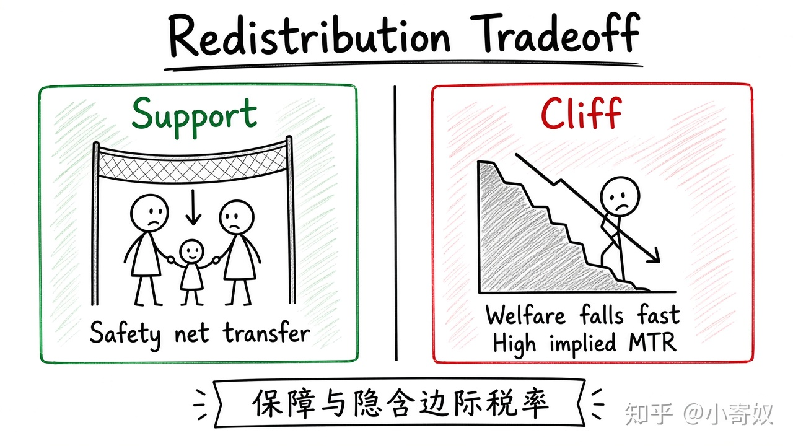

# 07｜贫困、再分配与激励

- 所属单元：Unit 08
- 建议用时：15 分钟
- 本节只解决：**帮助低收入者时，怎样同时考虑保障、激励与政策退出？**
- 导航：[上一节](06_lorenz_gini.md) · [返回单元首页](README.md) · [下一节](08_unit_review.md)

## 0～2 分钟：主动回忆

> 帮助低收入者时，怎样同时考虑保障、激励与政策退出？

## 本节术语

| 中文术语 | English | 缩写 | 通俗解释 |
|---|---|---|---|
| 贫困率 | Poverty Rate | 无通用缩写 | 收入低于官方贫困线的人口比例。 |
| 再分配 | Redistribution | 无通用缩写 | 通过税收和转移支付改变收入或财富分布。 |
| 边际税率 | Marginal Tax Rate | MTR | 新增一单位收入需要缴纳的税率。 |

## 2～9 分钟：核心内容

贫困率（Poverty Rate，无通用缩写）受贫困线、地区生活成本与非现金福利影响。再分配（Redistribution，无通用缩写）通过税收与转移支付改变分布，可提供保障并缓解风险。

若福利随收入增加迅速取消，会形成很高的隐含边际税率（Marginal Tax Rate, MTR），削弱工作激励——即「福利悬崖」。

设计时同时看公平、效率、行政成本、误伤与漏助。本节只讨论机制，不给出具体买卖或申报指令。

## 9～12 分钟：最小例子

某福利每增加 1 元收入就减少 0.8 元，加上显性税，新增工作收入大部分被抵消，可能形成福利悬崖。

## 12～14 分钟：你来做

设计一个帮助低收入家庭的方案：目标、领取条件、退出机制、一个激励副作用和一种缓解方法。

## 14～15 分钟：费曼复述

> 再分配改善 ______，但福利退出与税收可能提高隐含 ______，影响工作激励。

## 适用边界

贫困不仅是当期现金收入，还涉及健康、教育、住房、风险与代际机会。

## 完成证据

- [ ] 能说出本节英文术语与缩写
- [ ] 完成最小例子
- [ ] 保留了自己的判断过程
- [ ] 一句话复述与疑问已写入[工作簿](../workbook.md)
