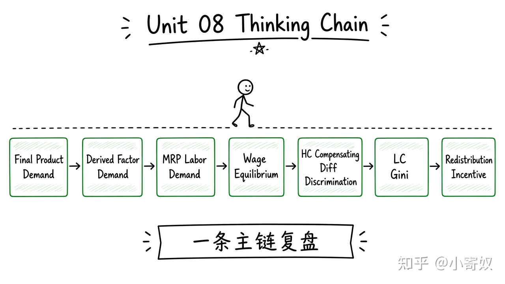

# 08｜单元复盘：工资差异与收入分配

- 所属单元：Unit 08
- 建议用时：15 分钟
- 本节只解决：**能否从产品需求推到工资，再区分生产率、补偿、歧视和政策影响？**
- 导航：[上一节](07_poverty_redistribution.md) · [返回单元首页](README.md)

## 0～2 分钟：主动回忆

> 能否从产品需求推到工资，再区分生产率、补偿、歧视和政策影响？

## 本节术语（复用）

| 中文术语 | English | 缩写 |
|---|---|---|
| 派生需求 | Derived Demand | 无通用缩写 |
| 边际收益产量 | Marginal Revenue Product | MRP |
| 人力资本 | Human Capital | HC |
| 基尼系数 | Gini Coefficient | Gini |

## 2～9 分钟：核心内容

闭卷回忆这一条主线（**一套流程，不要另起平行方案**）：



```text
最终产品需求 → 派生的要素需求
MP×MR → MRP → 劳动需求
劳动供给 ↔ 工资与就业
HC / 工作条件 / 歧视 → 工资差异
LC / Gini → 分配描述
税收与转移 → 再分配与激励
```

分析工资不能只看个人能力，也要看产品市场、技术、地点与制度。

## 9～12 分钟：最小例子

算法工程师高工资可能来自最终产品需求、技能稀缺与高 MRP，也可能含高强度工作补偿；不能直接推断每人生产率或福利都更高。

## 12～14 分钟：你来做

15 分钟：①算 VMP/MRP；②画劳动市场冲击；③分析两岗位工资差异；④解释 LC/Gini；⑤设计一项避免福利悬崖的政策。

## 14～15 分钟：费曼复述

> 工资来自劳动的 ______ 需求与供给；差异可能由 HC、工作条件和 ______ 共同造成；分配指标描述但不自动评价。

## 适用边界

本单元提供微观机制，不足以单独判断某职业或地区的实时工资，需要具体数据。

## 完成证据

- [ ] 能说出本节英文术语与缩写
- [ ] 完成最小例子
- [ ] 保留了自己的判断过程
- [ ] 一句话复述与疑问已写入[工作簿](../workbook.md)
