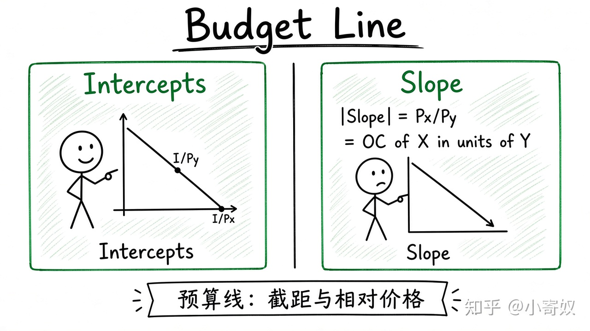

# 01｜预算约束与预算线

- 所属单元：Unit 09
- 建议用时：15 分钟
- 本节只解决：**收入和价格怎样限定消费者能够选择的商品组合？**
- 导航：[返回单元首页](README.md) · [下一节](02_preferences_indifference_curves.md)

## 0～2 分钟：主动回忆

先写一句你目前的判断（可以是「不知道」）：

> 收入和价格怎样限定消费者能够选择的商品组合？

## 本节术语

| 中文术语 | English | 缩写 | 通俗解释 |
|---|---|---|---|
| 预算约束 | Budget Constraint | BC | 给定收入和价格时，消费者可购买组合的边界。 |
| 预算线 | Budget Line | BL | 预算约束在两种商品图中的直线表示。 |
| 机会成本 | Opportunity Cost | OC | 作出选择时，最佳被放弃方案的价值。 |

> 第一次出现记住「中文（English, 缩写）」；无公认缩写就写「无通用缩写」，不要自造。

## 2～9 分钟：核心内容

预算约束（Budget Constraint, BC）表示给定收入与价格时可购买的全部组合。两种商品时刚好花完收入的组合构成预算线（Budget Line, BL）：

$$
P_X X+P_Y Y=I
$$

横轴 X、纵轴 Y 时，斜率绝对值为 $P_X/P_Y$，即多买 1 单位 X 要放弃多少 Y——X 以 Y 计的机会成本（OC）。

收入增加通常使 BL 平行外移；某一商品价格变化使 BL 绕另一轴截距旋转。

## 9～12 分钟：最小例子

收入 120 元，X=20 元，Y=10 元。最多买 6 个 X 或 12 个 Y，斜率=-2，表示多 1 个 X 需放弃 2 个 Y。

## 12～14 分钟：你来做

收入 200 元，X=25 元，Y=20 元。求两轴截距与斜率；再说明收入升到 250、X 降到 20 分别怎样改变 BL。

## 14～15 分钟：费曼复述

> BC 写成 ______；预算线斜率绝对值是 ______，表示 X 的相对价格和机会成本。

## 适用边界

模型假定价格与收入给定、商品可分割。信用、时间、最低购买单位与不确定收入会改变约束。

## 完成证据

- [ ] 能说出本节英文术语与缩写
- [ ] 完成最小例子
- [ ] 保留了自己的判断过程
- [ ] 一句话复述与疑问已写入[工作簿](../workbook.md)
