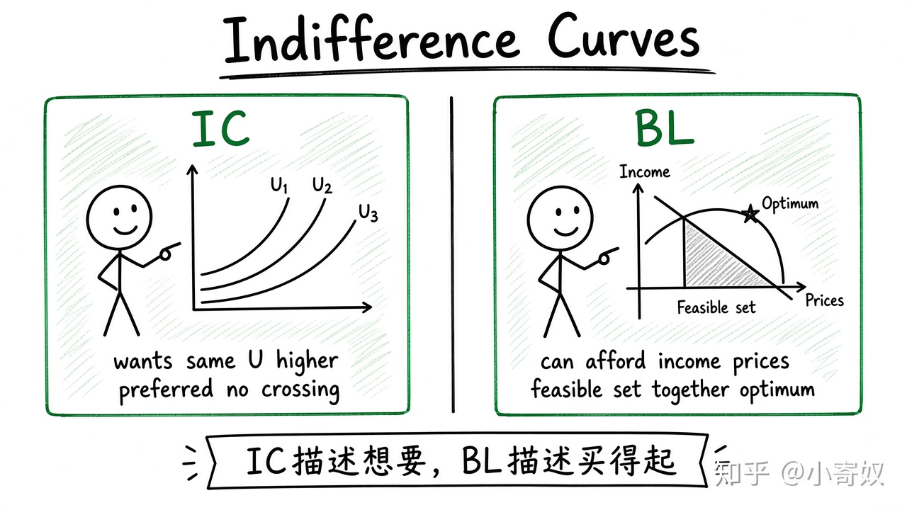

# 02｜偏好与无差异曲线

- 所属单元：Unit 09
- 建议用时：15 分钟
- 本节只解决：**怎样表示消费者对不同商品组合的偏好，而不直接给快乐定价？**
- 导航：[上一节](01_budget_constraint.md) · [返回单元首页](README.md) · [下一节](03_mrs.md)

## 0～2 分钟：主动回忆

> 怎样表示消费者对不同商品组合的偏好，而不直接给快乐定价？

## 本节术语

| 中文术语 | English | 缩写 | 通俗解释 |
|---|---|---|---|
| 效用 | Utility | U | 消费者从商品组合中获得的满足程度的抽象表示。 |
| 无差异曲线 | Indifference Curve | IC | 给消费者相同效用的商品组合轨迹。 |
| 最优选择 | Optimal Choice | 无通用缩写 | 预算约束内使消费者效用最高的商品组合。 |

## 2～9 分钟：核心内容

效用（Utility, U）是偏好排序的抽象指标，不必把「快乐」精确量化。无差异曲线（Indifference Curve, IC）连接给消费者相同效用的组合。

标准偏好下：IC 向右下倾斜；更高 IC 更受偏好；IC 不能相交；通常向原点凸。

IC 描述「想要什么」，预算线描述「买得起什么」。两者共同决定最优选择——仍是同一套框架。

## 9～12 分钟：最小例子

组合 A：2 杯咖啡 + 6 份面包；组合 B：3 杯咖啡 + 4 份面包。若消费者无差异，两点在同一 IC。更东北的可行组合通常效用更高。

## 12～14 分钟：你来做

画两条不相交的 IC 和一条预算线，标出一个不可达高效用点、一个可达但低效用点。

## 14～15 分钟：费曼复述

> IC 连接 ______ 相同的组合；更高 IC 通常更受偏好；它与 ______ 共同决定可行的最佳选择。

## 适用边界

真实偏好可能不稳定、有饱和点或受他人影响。标准 IC 是假设，不是心理事实的完整描述。

## 完成证据

- [ ] 能说出本节英文术语与缩写
- [ ] 完成最小例子
- [ ] 保留了自己的判断过程
- [ ] 一句话复述与疑问已写入[工作簿](../workbook.md)
