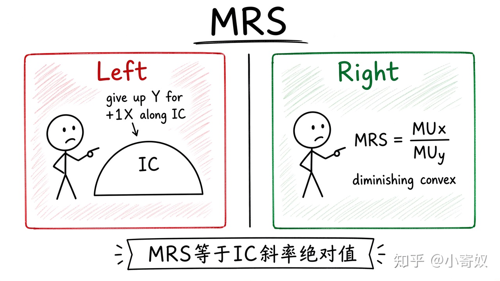

# 03｜边际替代率与相对偏好

- 所属单元：Unit 09
- 建议用时：15 分钟
- 本节只解决：**消费者愿意为多一单位商品 X 放弃多少商品 Y？**
- 导航：[上一节](02_preferences_indifference_curves.md) · [返回单元首页](README.md) · [下一节](04_consumer_optimum.md)

## 0～2 分钟：主动回忆

> 消费者愿意为多一单位商品 X 放弃多少商品 Y？

## 本节术语

| 中文术语 | English | 缩写 | 通俗解释 |
|---|---|---|---|
| 边际替代率 | Marginal Rate of Substitution | MRS | 消费者愿意为多一单位某商品放弃多少另一商品。 |
| 无差异曲线 | Indifference Curve | IC | 给消费者相同效用的商品组合轨迹。 |
| 边际效用 | Marginal Utility | MU | 多消费一单位商品带来的额外效用。 |

## 2～9 分钟：核心内容

边际替代率（Marginal Rate of Substitution, MRS）是沿同一 IC，为多获得 1 单位 X 愿意放弃的 Y 数量，等于 IC 斜率绝对值。可微效用下：

$$
MRS_{XY}=\frac{MU_X}{MU_Y}
$$

通常 X 越多、Y 越少，愿继续放弃的 Y 越少，MRS 递减，使 IC 向原点凸。MRS 反映主观交换意愿；价格比反映市场交换机会。

## 9～12 分钟：最小例子

当前愿为 1 杯咖啡放弃 3 份面包，MRS=3。咖啡已很多时，可能只愿放弃 1 份面包，MRS 下降。

## 12～14 分钟：你来做

若 U=X×Y，在点 (2,8) 与 (8,2) 处用 MU_X=Y、MU_Y=X 计算 MRS，并解释差异。

## 14～15 分钟：费曼复述

> MRS 表示消费者愿为 1 单位 ______ 放弃多少 ______；它等于 IC 斜率绝对值，也可写为 ______/______。

## 适用边界

MRS 是局部意愿，不保证能按该比率交易；实际选择还受市场价格与预算约束。

## 完成证据

- [ ] 能说出本节英文术语与缩写
- [ ] 完成最小例子
- [ ] 保留了自己的判断过程
- [ ] 一句话复述与疑问已写入[工作簿](../workbook.md)
