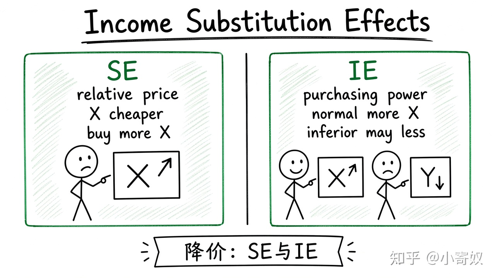

# 05｜收入效应与替代效应

- 所属单元：Unit 09
- 建议用时：15 分钟
- 本节只解决：**商品降价后，购买量为什么会通过两条不同渠道变化？**
- 导航：[上一节](04_consumer_optimum.md) · [返回单元首页](README.md) · [下一节](06_inferior_giffen.md)

## 0～2 分钟：主动回忆

> 商品降价后，购买量为什么会通过两条不同渠道变化？

## 本节术语

| 中文术语 | English | 缩写 | 通俗解释 |
|---|---|---|---|
| 收入效应 | Income Effect | IE | 价格变化通过改变实际购买力影响消费。 |
| 替代效应 | Substitution Effect | SE | 价格变化通过改变相对价格影响消费。 |
| 正常品 | Normal Good | 无通用缩写 | 收入增加时需求通常增加的商品。 |
| 低档品 | Inferior Good | 无通用缩写 | 收入增加时需求通常减少的商品；「低档」不等于质量差。 |

## 2～9 分钟：核心内容

价格变化同时产生两种作用。替代效应（Substitution Effect, SE）来自相对价格变化：X 降价后相对更便宜，倾向用 X 替代 Y。

收入效应（Income Effect, IE）来自实际购买力变化：同样收入能买更多。X 为正常品时，实际收入上升增加 X；为低档品时可能减少 X。

对正常品，降价时 SE 与 IE 都使 X 需求量增加。对低档品两者方向相反，通常 SE 更强，需求仍向下。

## 9～12 分钟：最小例子

公交票降价：SE 使人多坐公交；若公交是低档品，IE 可能让部分人改乘更舒适方式，但通常 SE 仍占主导。

## 12～14 分钟：你来做

分析汽油涨价对燃油车出行：分别写 SE、IE；再说明高收入与低收入家庭可能有什么差异。

## 14～15 分钟：费曼复述

> SE 来自 ______ 变化；IE 来自 ______ 变化。正常品价格下降时，两者通常都使需求量 ______。

## 适用边界

实际数据只观察总变化，分解 SE 与 IE 需要模型或实验。短期习惯与固定设备会限制调整。

## 完成证据

- [ ] 能说出本节英文术语与缩写
- [ ] 完成最小例子
- [ ] 保留了自己的判断过程
- [ ] 一句话复述与疑问已写入[工作簿](../workbook.md)
