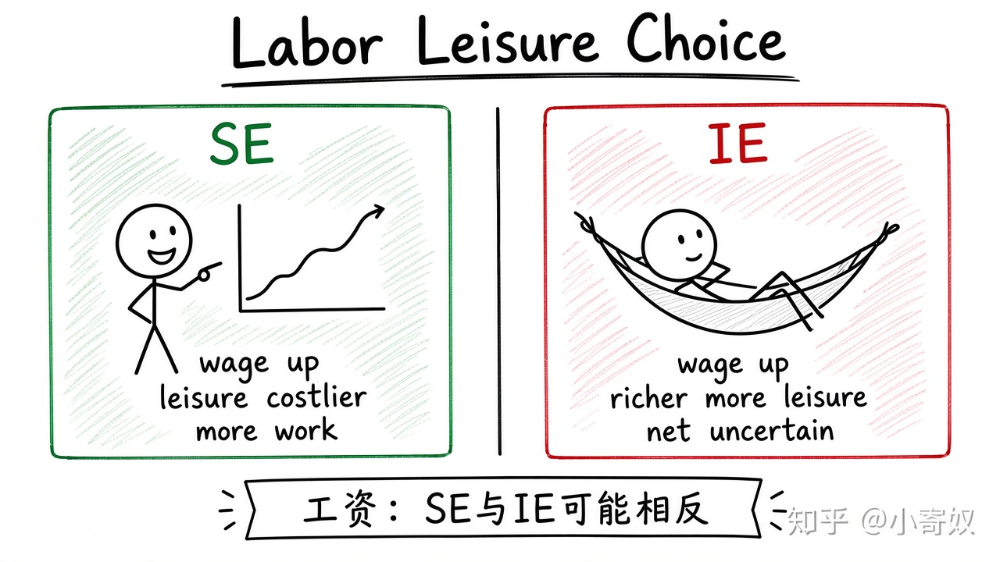

# 07｜劳动—闲暇与消费—储蓄选择

- 所属单元：Unit 09
- 建议用时：15 分钟
- 本节只解决：**工资或利率变化时，个人为什么可能作出方向相反的反应？**
- 导航：[上一节](06_inferior_giffen.md) · [返回单元首页](README.md) · [下一节](08_unit_review.md)

## 0～2 分钟：主动回忆

> 工资或利率变化时，个人为什么可能作出方向相反的反应？

## 本节术语

| 中文术语 | English | 缩写 | 通俗解释 |
|---|---|---|---|
| 劳动—闲暇选择 | Labor–Leisure Choice | 无通用缩写 | 个人在工作收入与闲暇之间进行的选择。 |
| 收入效应 | Income Effect | IE | 价格变化通过改变实际购买力影响消费。 |
| 替代效应 | Substitution Effect | SE | 价格变化通过改变相对价格影响消费。 |

## 2～9 分钟：核心内容

工资是放弃 1 小时闲暇的机会成本。工资上升使闲暇更贵 → SE 促使多工作；收入提高且闲暇为正常品 → IE 促使多休息。劳动供给可能增加、减少或后弯。

消费—储蓄同理：利率上升的 SE 鼓励储蓄；对已有储蓄者，利息收入增加的 IE 可能让今天消费更多，方向不确定。

关键仍是分开相对价格变化与购买力变化——同一套 SE/IE 框架。

## 9～12 分钟：最小例子

加薪后，早期职业者可能多加班积累资金；高收入者可能少工作、多休假。相同冲击因 IE 与 SE 大小不同产生不同反应。

## 12～14 分钟：你来做

分析你工资上涨 20% 时的劳动—闲暇选择：SE 方向、IE 方向、你预计哪一个更强及原因。

## 14～15 分钟：费曼复述

> 工资上涨使闲暇相对更 ______，SE 促使工作 ______；IE 可能促使闲暇 ______，所以总方向不确定。

## 适用边界

税收、合同工时、家庭责任与职业晋升会约束选择；简单模型不是对真实劳动行为的完整预测。

## 完成证据

- [ ] 能说出本节英文术语与缩写
- [ ] 完成最小例子
- [ ] 保留了自己的判断过程
- [ ] 一句话复述与疑问已写入[工作簿](../workbook.md)
