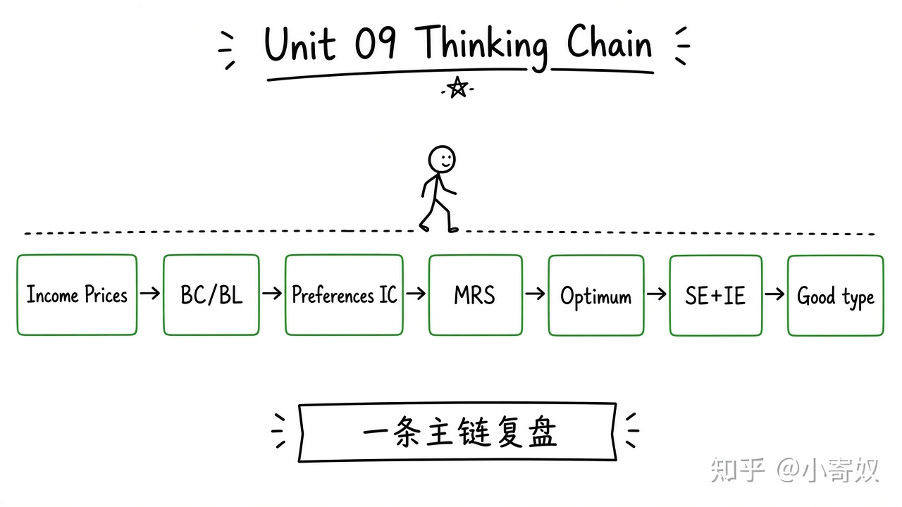

# 08｜单元复盘：从预算约束到最优选择

- 所属单元：Unit 09
- 建议用时：15 分钟
- 本节只解决：**能否把价格、收入、偏好和消费者选择连成一张图？**
- 导航：[上一节](07_labor_leisure_saving.md) · [返回单元首页](README.md)

## 0～2 分钟：主动回忆

> 能否把价格、收入、偏好和消费者选择连成一张图？

## 本节术语（复用）

| 中文术语 | English | 缩写 |
|---|---|---|
| 预算约束 | Budget Constraint | BC |
| 无差异曲线 | Indifference Curve | IC |
| 边际替代率 | Marginal Rate of Substitution | MRS |
| 收入效应 | Income Effect | IE |
| 替代效应 | Substitution Effect | SE |

## 2～9 分钟：核心内容

闭卷回忆这一条主线（**一套流程，不要另起平行方案**）：



```text
收入与价格 → BC / BL
偏好 → IC
IC 斜率 → MRS
最高可达 IC → 最优选择
价格变化 → SE + IE
商品类别 → 总需求反应
```

分析消费者变化时：先画预算线变化，再判断相对价格与实际购买力，最后结合商品性质。

## 9～12 分钟：最小例子

燃油涨价使 BL 旋转；燃油相对变贵产生 SE，实际购买力下降产生 IE。总出行变化还受替代交通与车辆存量限制。

## 12～14 分钟：你来做

15 分钟：①画预算线；②画 IC 和最优点；③判断 MRS 调整方向；④分解价格变化；⑤解释低档品不等于吉芬品。

## 14～15 分钟：费曼复述

> 消费者选择由 ______ 与偏好共同决定；内部最优满足 MRS 等于 ______；价格效应可分为 ______ 和 ______。

## 适用边界

本单元用理性、一致偏好作为基准。下一单元讨论信息不足、心理偏差与制度选择。

## 完成证据

- [ ] 能说出本节英文术语与缩写
- [ ] 完成最小例子
- [ ] 保留了自己的判断过程
- [ ] 一句话复述与疑问已写入[工作簿](../workbook.md)
