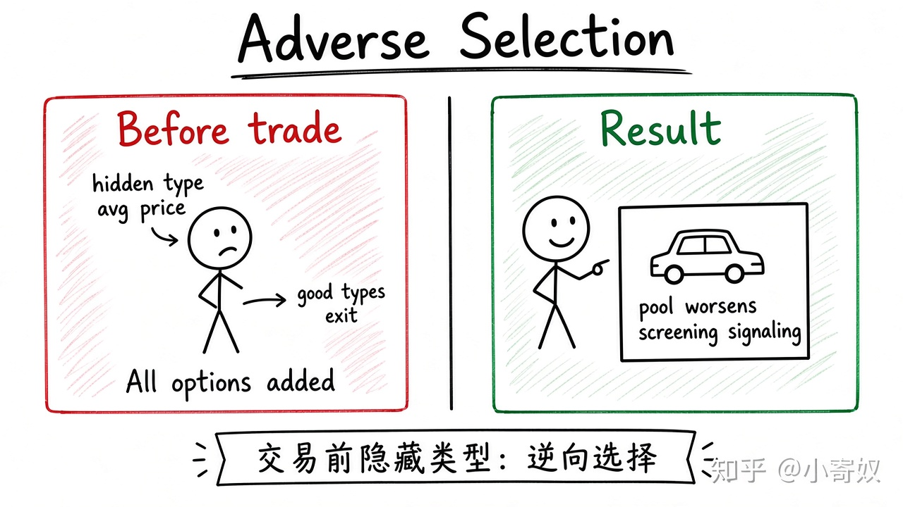

# 01｜信息不对称与逆向选择

- 所属单元：Unit 10
- 建议用时：15 分钟
- 本节只解决：**交易前看不清质量或风险时，为什么好产品可能退出市场？**
- 导航：[返回单元首页](README.md) · [下一节](02_moral_hazard_principal_agent.md)

## 0～2 分钟：主动回忆

先写一句你目前的判断（可以是「不知道」）：

> 交易前看不清质量或风险时，为什么好产品可能退出市场？

## 本节术语

| 中文术语 | English | 缩写 | 通俗解释 |
|---|---|---|---|
| 信息不对称 | Asymmetric Information | AI | 交易双方掌握的信息不同。（与人工智能同缩写，正文尽量写全称。） |
| 逆向选择 | Adverse Selection | AS | 交易前，隐藏信息使高风险或低质量对象更容易进入市场。 |
| 筛选 | Screening | 无通用缩写 | 信息较少的一方设计选择机制以识别不同类型。 |

> 第一次出现记住「中文（English, 缩写）」；无公认缩写就写「无通用缩写」，不要自造。

## 2～9 分钟：核心内容

信息不对称（Asymmetric Information, AI）指交易双方掌握的信息不同——此处 AI 是经济学术语，不是人工智能。

逆向选择（Adverse Selection, AS）发生在**交易前**：隐藏类型使高风险或低质量对象更愿参与。买方按平均质量出价 → 高质量卖方退出 → 平均质量进一步下降。

信息较少一方可用筛选（Screening，无通用缩写）；信息较多一方可发信号。固定顺序：交易前 / 交易后 → 隐藏类型还是隐藏行为。

## 9～12 分钟：最小例子

保险公司无法完全识别风险，统一高保费会赶走低风险客户，留下更多高风险客户，进一步推高保费。

## 12～14 分钟：你来做

分析二手自动驾驶传感器市场：卖方知道什么？买方担心什么？设计一种检测、质保或合同筛选。

## 14～15 分钟：费曼复述

> 信息不对称是双方掌握信息 ______；AS 发生在交易 ______，隐藏类型会改变参与者构成。

## 适用边界

信息不对称不必导致市场完全消失。声誉、平台担保、第三方检测与长期关系可缓解。

## 完成证据

- [ ] 能说出本节英文术语与缩写
- [ ] 完成最小例子
- [ ] 保留了自己的判断过程
- [ ] 一句话复述与疑问已写入[工作簿](../workbook.md)
