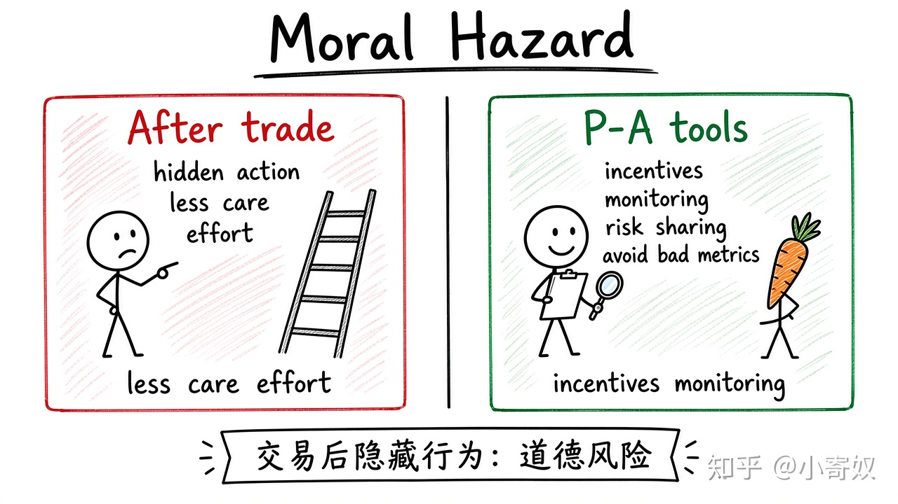

# 02｜道德风险与委托—代理问题

- 所属单元：Unit 10
- 建议用时：15 分钟
- 本节只解决：**签约之后，行为难以观察时，为什么人可能承担更多风险或减少努力？**
- 导航：[上一节](01_asymmetric_information_adverse_selection.md) · [返回单元首页](README.md) · [下一节](03_signaling_screening.md)

## 0～2 分钟：主动回忆

> 签约之后，行为难以观察时，为什么人可能承担更多风险或减少努力？

## 本节术语

| 中文术语 | English | 缩写 | 通俗解释 |
|---|---|---|---|
| 道德风险 | Moral Hazard | MH | 交易后，因行为难以观察而采取更高风险或更少努力。 |
| 委托—代理问题 | Principal–Agent Problem | P–A | 代理人的目标和信息与委托人不同，导致行动偏离委托人利益。 |
| 激励 | Incentive | 无通用缩写 | 改变某种行为相对收益或相对成本的因素。 |

## 2～9 分钟：核心内容

道德风险（Moral Hazard, MH）发生在**交易后**：保护或合同改变激励，而行动难以观察。全额保险后，防范损失的边际收益下降。

委托—代理问题（Principal–Agent Problem, P–A）中，委托人与代理人目标不同、代理人信息更多。工具包括绩效合同、共担、监控与声誉——但指标设计不当会诱发「只优化可测指标」。

## 9～12 分钟：最小例子

算法团队只按离线精度考核，工程师可能忽略延迟、稳定性与数据泄漏——指标提高了某项激励，却偏离量产目标。

## 12～14 分钟：你来做

选一个工作 P–A 问题：委托人目标、代理人目标、不可观察行为、一个激励方案和一个副作用。

## 14～15 分钟：费曼复述

> MH 发生在交易 ______，核心是不可观察行为与激励改变；P–A 问题来自目标不一致和 ______ 差异。

## 适用边界

更强监控也有隐私、信任与行政成本；最优合同通常在激励与风险分担间权衡。

## 完成证据

- [ ] 能说出本节英文术语与缩写
- [ ] 完成最小例子
- [ ] 保留了自己的判断过程
- [ ] 一句话复述与疑问已写入[工作簿](../workbook.md)
