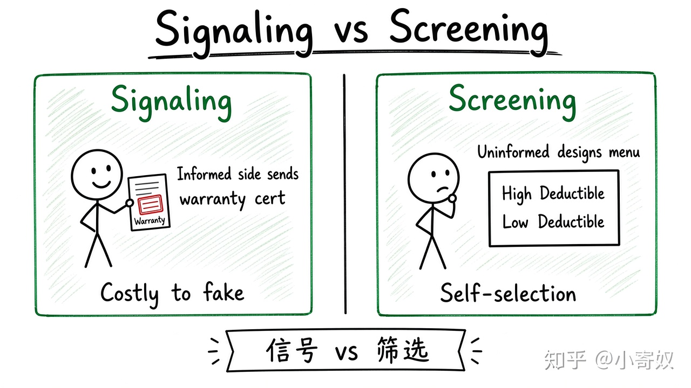

# 03｜信号与筛选

- 所属单元：Unit 10
- 建议用时：15 分钟
- 本节只解决：**市场参与者怎样用可验证行为区分不同类型？**
- 导航：[上一节](02_moral_hazard_principal_agent.md) · [返回单元首页](README.md) · [下一节](04_collective_choice_government_failure.md)

## 0～2 分钟：主动回忆

> 市场参与者怎样用可验证行为区分不同类型？

## 本节术语

| 中文术语 | English | 缩写 | 通俗解释 |
|---|---|---|---|
| 信号 | Signaling | 无通用缩写 | 掌握私人信息的一方向另一方主动传递可信信息。 |
| 筛选 | Screening | 无通用缩写 | 信息较少的一方设计选择机制以识别不同类型。 |
| 信息不对称 | Asymmetric Information | AI | 交易双方掌握的信息不同。 |

## 2～9 分钟：核心内容

信号（Signaling，无通用缩写）由信息较多一方主动发出（质保、认证、试用）。有效信号须让高质量类型更容易或更低成本地发送，否则低质量者会模仿。

筛选（Screening，无通用缩写）由信息较少一方设计（免赔额、分层套餐、技术测试），让不同类型自行选择。

教育可能既提升人力资本，也可能向雇主发出能力与坚持信号——两种机制可并存。

## 9～12 分钟：最小例子

高质量厂商提供长期质保的预期成本较低，低质量厂商模仿成本高 → 质保可能成为可信信号。买方设置试用与验收则属于筛选。

## 12～14 分钟：你来做

分别为招聘和 SaaS 采购设计一个信号、一个筛选机制，并说明低质量类型为什么难以模仿。

## 14～15 分钟：费曼复述

> 信号由信息 ______ 的一方发出；筛选由信息 ______ 的一方设计；可信信号需满足类型间成本差异。

## 适用边界

证书或品牌可能成为昂贵但低信息量的信号。应检查它与真实质量的稳定关系。

## 完成证据

- [ ] 能说出本节英文术语与缩写
- [ ] 完成最小例子
- [ ] 保留了自己的判断过程
- [ ] 一句话复述与疑问已写入[工作簿](../workbook.md)
