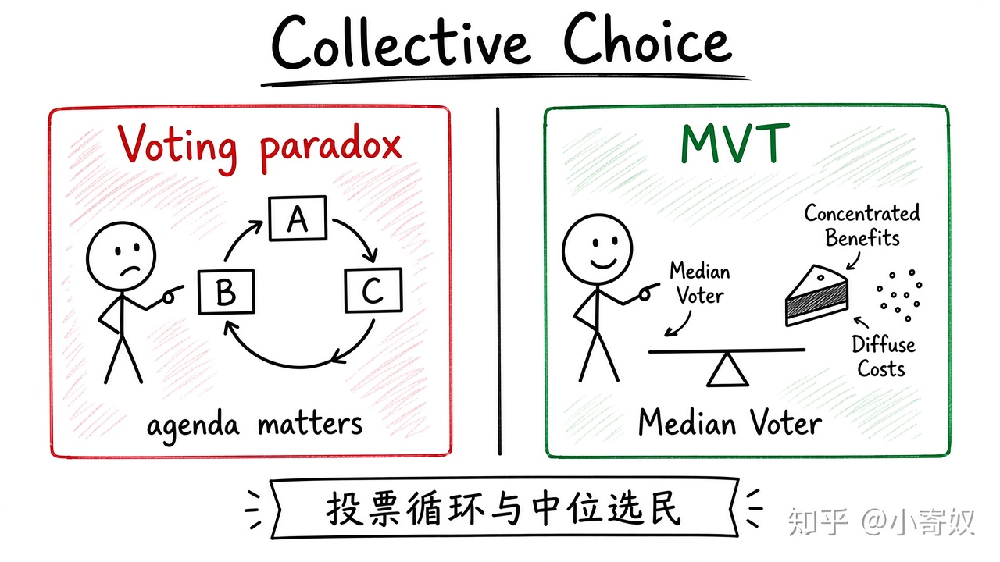

# 04｜集体选择、中位选民与政府失灵

- 所属单元：Unit 10
- 建议用时：15 分钟
- 本节只解决：**个人偏好合理时，集体政策为什么仍可能循环、向中间靠拢或偏离公共利益？**
- 导航：[上一节](03_signaling_screening.md) · [返回单元首页](README.md) · [下一节](05_behavioral_bounded_rationality.md)

## 0～2 分钟：主动回忆

> 个人偏好合理时，集体政策为什么仍可能循环、向中间靠拢或偏离公共利益？

## 本节术语

| 中文术语 | English | 缩写 | 通俗解释 |
|---|---|---|---|
| 投票悖论 | Voting Paradox | 无通用缩写 | 多数票偏好可能循环，无法形成稳定社会排序。 |
| 中位选民定理 | Median Voter Theorem | MVT | 在特定条件下，多数制竞争会使政策向中位选民偏好靠近。 |
| 规范表述 | Normative Statement | 无通用缩写 | 讨论应该怎样，包含价值排序与伦理判断。 |

## 2～9 分钟：核心内容

投票悖论（Voting Paradox，无通用缩写）说明多数票社会偏好可能循环：A 胜 B、B 胜 C、C 又胜 A。议程顺序会影响结果。

中位选民定理（Median Voter Theorem, MVT）在单一维度、单峰偏好与多数制等条件下，候选人向中位选民靠拢；现实政策多维，条件常不完全成立。

政府还可能失灵：集中受益者游说强、分散承担者动力弱。分析政策要检查投票规则、信息、激励与问责——不是第二套框架，而是同一套激励逻辑。

## 9～12 分钟：最小例子

三人排序可形成 A>B、B>C、C>A。若补贴让少数企业获大利、每位纳税人只承担小成本，可能因集中游说长期存在。

## 12～14 分钟：你来做

验证三人排序的投票循环；再选一项行业补贴，列出集中受益者、分散承担者、信息差与问责机制。

## 14～15 分钟：费曼复述

> 投票悖论说明多数偏好可能 ______；MVT 在特定条件下使政策靠近 ______；政府失灵来自信息、激励和 ______。

## 适用边界

这些结论不表示民主或政府必然失败，而是要求透明程序、权利保障与制度比较。

## 完成证据

- [ ] 能说出本节英文术语与缩写
- [ ] 完成最小例子
- [ ] 保留了自己的判断过程
- [ ] 一句话复述与疑问已写入[工作簿](../workbook.md)
