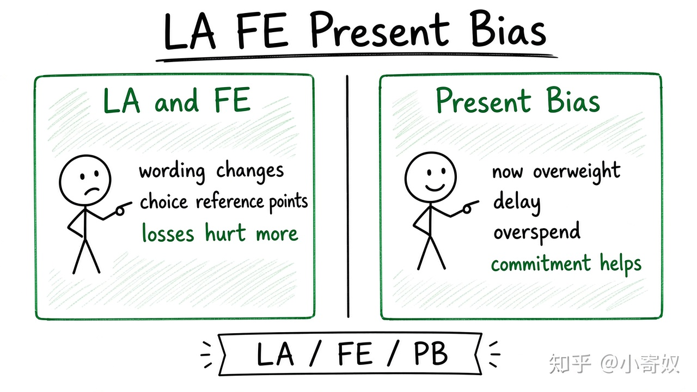

# 06｜损失厌恶、框架效应与现时偏误

- 所属单元：Unit 10
- 建议用时：15 分钟
- 本节只解决：**同样的经济结果为什么会因参考点、表述和时间而引发不同选择？**
- 导航：[上一节](05_behavioral_bounded_rationality.md) · [返回单元首页](README.md) · [下一节](07_nudge_endowment_ethics.md)

## 0～2 分钟：主动回忆

> 同样的经济结果为什么会因参考点、表述和时间而引发不同选择？

## 本节术语

| 中文术语 | English | 缩写 | 通俗解释 |
|---|---|---|---|
| 损失厌恶 | Loss Aversion | LA | 同等金额损失带来的痛苦通常大于收益带来的快乐。 |
| 框架效应 | Framing Effect | FE | 同一问题的不同表述方式会改变选择。 |
| 现时偏误 | Present Bias | PB | 对即时收益给予过高权重，低估未来后果。 |

## 2～9 分钟：核心内容

损失厌恶（Loss Aversion, LA）指同等金额损失的痛苦通常大于收益的快乐。框架效应（Framing Effect, FE）使「成功率 90%」与「失败率 10%」引发不同选择。现时偏误（Present Bias, PB）让人过度重视即时收益，导致拖延或过度消费。

这些偏差可解释订阅续费与健康行为，但需与风险偏好、信息与约束区分。涉及投资时只讨论机制，不给具体买卖指令。

## 9～12 分钟：最小例子

一项标的从买入价下跌 20%，投资者因 LA 不愿确认损失；但买入价是历史参考点，不应替代对未来收益与风险的判断。

## 12～14 分钟：你来做

把同一方案分别写成收益框架与损失框架；再写一个现时偏误导致拖延的例子和承诺机制。

## 14～15 分钟：费曼复述

> LA 围绕 ______ 放大损失；FE 使 ______ 改变选择；PB 让即时收益权重过 ______。

## 适用边界

偏差是统计倾向，不代表每个人每次都如此。干预前应验证实际行为与情境。

## 完成证据

- [ ] 能说出本节英文术语与缩写
- [ ] 完成最小例子
- [ ] 保留了自己的判断过程
- [ ] 一句话复述与疑问已写入[工作簿](../workbook.md)
