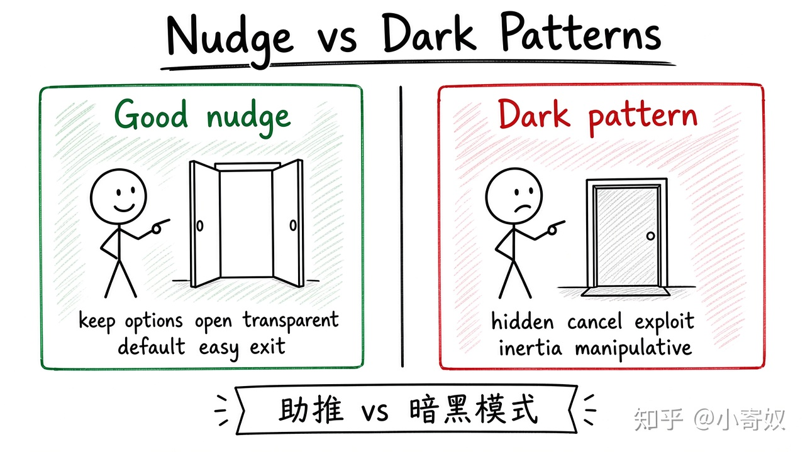

# 07｜禀赋效应、助推与选择架构

- 所属单元：Unit 10
- 建议用时：15 分钟
- 本节只解决：**怎样在不禁止选项的情况下改善决策，又避免操纵？**
- 导航：[上一节](06_loss_framing_present_bias.md) · [返回单元首页](README.md) · [下一节](08_unit_review.md)

## 0～2 分钟：主动回忆

> 怎样在不禁止选项的情况下改善决策，又避免操纵？

## 本节术语

| 中文术语 | English | 缩写 | 通俗解释 |
|---|---|---|---|
| 禀赋效应 | Endowment Effect | EE | 拥有某物后对它的估值往往提高。 |
| 助推 | Nudge | 无通用缩写 | 不禁止选项、也不显著改变经济激励，通过选择架构影响行为。 |
| 框架效应 | Framing Effect | FE | 同一问题的不同表述方式会改变选择。 |

## 2～9 分钟：核心内容

禀赋效应（Endowment Effect, EE）指拥有后估值往往提高。免费试用、默认续费可能利用 EE 与损失厌恶。

助推（Nudge，无通用缩写）通过选择架构影响行为，不禁止选项、也不显著改变经济激励，例如默认加入养老金与设置提醒。

评估要看透明度、退出难度、目标是否符合使用者利益。好的架构降低认知成本；坏的「暗黑模式」利用偏差锁定用户。

## 9～12 分钟：最小例子

订阅默认自动续费且取消入口隐蔽，形式上可退出，却利用惯性与认知成本——更接近暗黑模式而非有益助推。

## 12～14 分钟：你来做

重新设计一个软件订阅页面：保留选择自由，同时让价格、续费与取消清楚。写出默认选项及伦理理由。

## 14～15 分钟：费曼复述

> EE 使拥有后估值 ______；Nudge 通过 ______ 影响行为，但应保持透明和易于 ______。

## 适用边界

助推不能替代价格、监管或基本权利保障。若外部损害严重，单靠提醒可能不足。

## 完成证据

- [ ] 能说出本节英文术语与缩写
- [ ] 完成最小例子
- [ ] 保留了自己的判断过程
- [ ] 一句话复述与疑问已写入[工作簿](../workbook.md)
