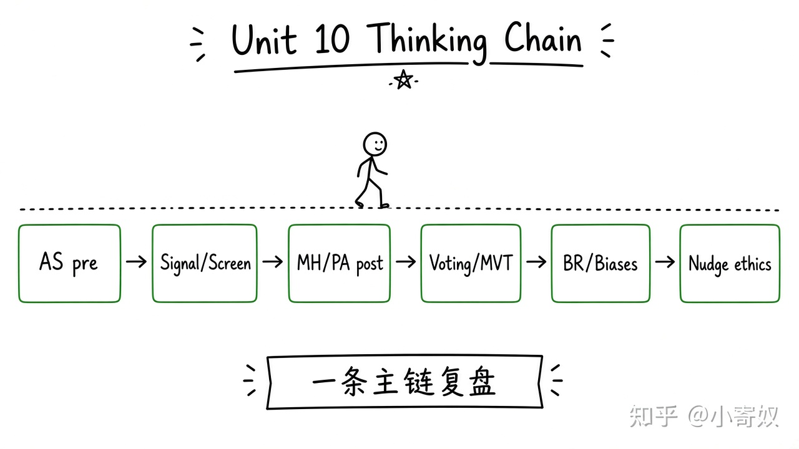

# 08｜单元复盘：信息、政治与行为

- 所属单元：Unit 10
- 建议用时：15 分钟
- 本节只解决：**能否识别市场与政策中隐藏信息、隐藏行为和心理偏差？**
- 导航：[上一节](07_nudge_endowment_ethics.md) · [返回单元首页](README.md)

## 0～2 分钟：主动回忆

> 能否识别市场与政策中隐藏信息、隐藏行为和心理偏差？

## 本节术语（复用）

| 中文术语 | English | 缩写 |
|---|---|---|
| 信息不对称 | Asymmetric Information | AI |
| 道德风险 | Moral Hazard | MH |
| 中位选民定理 | Median Voter Theorem | MVT |
| 行为经济学 | Behavioral Economics | BE |
| 助推 | Nudge | 无通用缩写 |

## 2～9 分钟：核心内容

闭卷回忆这一条主线（**一套流程，不要另起平行方案**）：



```text
交易前隐藏类型 → AS → 信号 / 筛选
交易后隐藏行为 → MH / P–A → 合同 / 监控 / 共担
集体选择与心理限制 → 投票规则 / BR / 偏差 → 制度与助推
```

最后选保险、招聘、平台订阅或行业补贴之一，指出信息问题、激励问题、行为偏差与伦理边界。

## 9～12 分钟：最小例子

保险同时有 AS 与 MH：高风险者更愿投保，投保后又可能减少防范。免赔额既筛选类型，也让投保人承担部分损失。

## 12～14 分钟：你来做

15 分钟：①区分 AS 与 MH；②设计信号和筛选；③验证投票循环；④识别 LA/FE/PB；⑤评价一个助推是否透明。

## 14～15 分钟：费曼复述

> 前沿微观经济学把标准模型扩展到 ______、政治规则和心理限制；改进制度要同时检查激励、证据与 ______。

## 适用边界

这些概念是诊断工具，不是给任何结果贴标签的借口。必须说明具体机制和可观察证据。

## 完成证据

- [ ] 能说出本节英文术语与缩写
- [ ] 完成最小例子
- [ ] 保留了自己的判断过程
- [ ] 一句话复述与疑问已写入[工作簿](../workbook.md)
