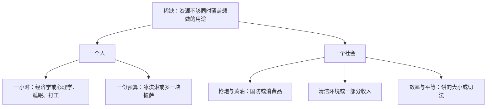

# 人们面临权衡

> 学习目标
> - 在一个课本情景里点出不够用的资源，并写出多得到的一边与少掉的一边
> - 把「枪炮与黄油」「清洁环境与收入」和「效率与平等」分成不同的对子
> - 停在看清让步，不在这一页宣布哪一边该赢

<!-- block:section role=intro -->
## 不够同时用完，选择就变成让步

把今晚想做的事摊开：读经济学、读心理学、睡觉、骑车、看电视，或者去打工挣一点钱。若手里只剩一小时，这一小时不会分成六份，让六件事一起做完。你多给经济学一小时，心理学、睡眠或那份工时里，就有一件要让出来。

家里花钱是同一件事的另一副样子。一块钱买了食物、衣服或一次出游，留给退休、留给子女教育的钱就少一截。饭桌把这句话收得更短：预算只够再加一份时，多买一盒冰淇淋，披萨就少一块。少掉的不是「抽象的钱」，是那一块本来可以端上桌的披萨。

经济学把「资源不够把想做的用途一起做完」叫做稀缺。稀缺一旦成立，选择就不再是收藏愿望，而是权衡：要得到自己喜欢的一边，通常就得放下另一件也喜欢的东西。曼昆把这条放在十条原理的起手处，因为后面的成本、再多一单位、以及规则如何改写行为，都要先知道你放弃的是什么。你若跳过这一步，直接宣布「我选效率」或「我选环保」，账本的第一行就是空的。

先练一个很小的动作，暂时不要表态。第一句：不够用的是哪一种资源，时间、收入，还是一国的劳动和机器？第二句：多拿到这边时，具体少掉的是哪一边？学生的例子里资源是时间。家庭的例子里资源是收入。社会把许多人的资源放在一起以后，两边换成公共目标，动作仍然是这两句。

<!-- block:figure -->

稀缺是同一个支点。从支点分出去的对子并不相同，所以不能看见「有取舍」就把所有对子写成一对。

<!-- block:callout variant=key_idea -->
> **要点：** 权衡是多得到一边，就少得到另一边。把少掉的那一边写具体，这一页的任务就完成了一大半。选边是以后的事。

<!-- block:text role=bridge -->
个人的一小时很好写。社会的目标一多，对子就容易并错。下面三对都来自这一章的课堂情景，请分开抄在三行里。

<!-- block:section role=example -->
## 三对课本情景，各写各的少掉的一边

枪炮与黄油问的是一国有限的劳动、土地和机器往哪边送。更多用于国防，用来提高国内生活水平的消费品就少。黄油在这里是黄油、面包、衣服这一类日常物品的代称，不是某种食品单独涨价。你若把这对写成「国防代表饼大、黄油代表分得匀」，两件不同的事就被粘在了一起。

清洁的环境与收入是另一对。法律要求企业少排污，生产成本上去。上去的成本会在某处显形：利润变薄，工资变低，售价变高，或三处都有一点。得到的是更干净的空气和更好的健康。放弃的是企业主、工人和顾客手里的一部分收入。这里少掉的是物质收入，不是「饼切得不匀」这一个短语所能代替的。

效率与平等再换一个问题。效率关心饼尽量做大，同样的资源换成更多人们所看重的东西。平等关心饼和负担怎样分。福利、失业保险、让高收入的人多交所得税，用意常常是把好处分得更匀。工作带回家的回报变小以后，人们可能少工作、少生产，饼本身常常跟着小一圈。这对权衡的两边是「切法」和「饼的大小」。它值得认真对待，但它不是枪炮与黄油的别名，也不是环境管制的别名。

三对可以出现在同一个社会里，甚至出现在同一次讨论里。讨论要往前走，就得先问：这一句少掉的，是消费品、是收入，还是饼变小？问清之后再决定值不值得。学生不必为了多读一小时经济学就放弃心理学。社会也不必因为环保会压低一些物质生活水平，就因此停止保护环境。看清让步，是为了知道代价写在哪一边，不是为了在这一页宣布赢家。

把家庭的一块钱再走慢一点。多买食物、衣服或一次出游，留给退休和子女教育的就少一截。少掉的不是一句「以后再说」，而是那些用途里具体被挤掉的一件。个人的让步和社会的让步用的是同一种句子，只是不够用的东西从一小时换成了一国的劳动、土地和机器。你若只能说出「总要有所放弃」，还没有完成这一页。你要能指出：多得到的是哪一边，少掉的具体是哪一边。

人也容易在写清两边之前就投票。有人看见环保让收入变紧，就主张不管；有人看见国防重要，就主张消费品可以先让。这些都是选择，不是这一页要替你做的选择。这一页要的是两行可以核对的话：得到什么，放下什么。两行写清以后，不同的人仍可以站在不同的边。站在不同的边，只说明评价不同，不说明有人没看见权衡。效率与平等尤其容易被拿来当总名称。福利和累进的所得税确实在动切法和饼的大小，可是枪炮与黄油动的是资源的去向，环境管制动的是清洁和收入。名称一旦用混，后面的成本就会记到错误的那一边上。

<!-- block:callout variant=common_pitfall -->
> **误区：** 一看到「社会必须取舍」，就自动答成效率对平等。先把少掉的东西写成消费品、收入或饼的大小，再决定它是哪一对。

<!-- block:quiz difficulty=mixed num_questions=3 -->
### 1

预算只够再加一份。多一盒冰淇淋，披萨少一块。这一幕最直接在练什么？

- A. 把所有没吃的甜品加总成一笔成本
- B. 多得到一边，就少得到另一边
- C. 物价总体正在上升
- D. 镇上只有一家店所以能定高价

答案

B。不够用的是这一份预算。A 把权衡收成了加总，那是下一页才要挡住的算法。C、D 分别是后面的边界和另一扇门。

### 2

「枪炮与黄油」少掉的一边主要是什么？

- A. 用于提高生活水平的消费品
- B. 饼切得是否均匀
- C. 下一张机票的花生
- D. 货币发行得太多

答案

A。资源更多用于国防，消费品就少。B 是效率与平等。

### 3

福利和让高收入者多交税，常常同时碰到的让步是哪一句？

- A. 国防多一点，黄油少一点
- B. 好处分得更匀，饼本身可能变小
- C. 开车变贵，人们改坐公交
- D. 好车退出旧车市场

答案

B。这是效率与平等。切得更匀时，工作的回报变小，人们可能少工作、少生产。

<!-- block:flash_cards -->
| front | back | hint |
|---|---|---|
| 稀缺在这一页指什么 | 资源不够把想做的用途一起做完 | 不是「标价很高」 |
| 冰淇淋与披萨少掉什么 | 多一盒冰淇淋，就少一块披萨 | 支点是那一份预算 |
| 枪炮与黄油 | 资源用于国防，消费品就少 | 不要写成切饼 |
| 效率 | 把人们所看重的饼做大 | 大小，不是切法 |
| 平等 | 好处和负担分得更匀 | 切匀常常让饼变小 |

<!-- block:deep_dive -->
| topic | rationale |
|---|---|
| 少掉的许多事里，哪一件才算成本 | 权衡可以列出好几件没做的事。记账若把它们全部加总，成本会被写得过大。下一页只保留你真正会去的那一个下一选择。 |
| 环境管制怎样改写「再多生产一点」 | 这一页只看见收入让了一让。烟尘落到没参加生产决策的人身上、却没进企业账单时，就走到政府能否改善结果的那一扇门。 |
| 切饼如何回头改变工作的意愿 | 平等不是一句口号。回报变小以后，人们可能少干活。那是激励会把行为推开的同一类事情，值得在激励那一页再看一眼。 |
