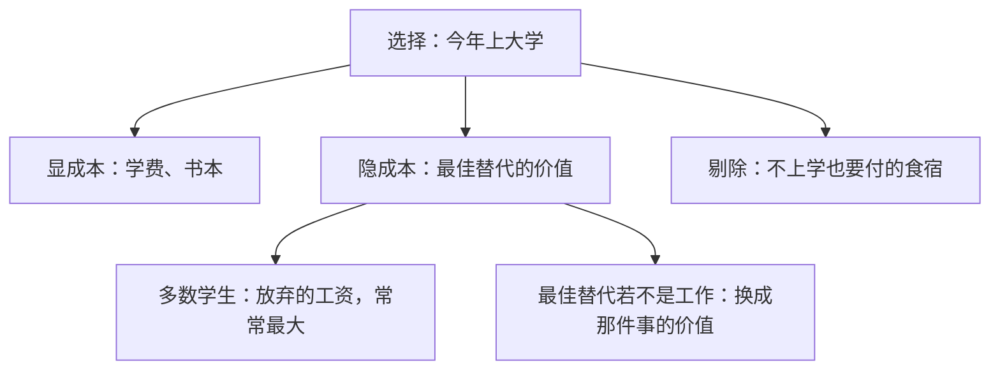

# 成本是为了得到它所放弃的东西

> 学习目标
> - 列出上大学的显成本、常常最大的隐成本，以及食宿里该剔除的部分
> - 说明机会成本只记最佳替代
> - 在最佳替代不是工作时，把工资换成那一件事的价值

<!-- block:section role=core -->
## 账单只是成本的一部分

人既然要在两边之间让步，做决定就是在比不同做法的好处和代价。代价常常比收据上的数字更难看见。一件东西的成本，是为了得到它所放弃的东西。这个「放弃的东西」叫机会成本。

上大学把这件事摊开得最清楚。上学的好处是知识，以及日后更好的工作机会。若只把学费、书本和食宿加在一张纸上，你还没有回答：为了读这一年，你放下了什么。

放下的第一件，常常是不去工作本来可以挣到的收入。对多数学生，这笔没拿到手的工资，比学费那张收据还大。它没有新账单，所以容易被忘掉。忘掉它，就会把「今年看起来没花多少钱」误当成「今年的成本不高」。

食宿要拆开看。人不上学也要有地方住、有饭吃。两边都要付的那一截，并不因为你走进了校园就变成大学特有的代价。只有因为住校而比住在家里多出来的部分，才进入上学的成本。整笔食宿都算进去，等于把「活着也要吃饭」写成了「读书的代价」。

同时能想起来的没做的事往往不止一件：睡觉、旅行、另一门专业、一份普通工作、一份很高的合同。机会成本不把这张清单加总。你这一年只会走向一个下一选择，也就是最佳替代。成本停在那一阶。排在它后面的愿望，并不因为同样没被选中，就取得进入总额的资格。

职业运动员把最佳替代换成一份很高的打球收入时，上大学的机会成本就特别高。有人会据此判断，上学的好处抵不上这份放下的收入。这是同一本账，不是对一个人用功与否的评语。若你的最佳替代根本不是工作，而是另一件你真会去做的事，工资就退出这本账，换成那件事对你的价值。

还可以把最佳替代想成队伍里的下一名，而不是把愿望铺成一张可以相加的清单。只有下一名进账。排在更后面的事即使也很诱人，也只是没有被选中的背景。运动员的下一名是高薪打球，所以学费那一行突然不再决定一切。多数学生的下一名是一份真能拿到的工资，于是没有账单的那一项盖过了收据。你若说不出自己的下一名是谁，就先不要报一个很大的总数。先把两条你真会走的路写在左右两边，再问：从一边走到另一边，多付了哪些钱，又放下了哪一件真会发生的事。

食宿最容易把两边相同的部分误当成差额。不上学，人一样要吃饭、要有地方睡。把整笔食宿写进大学，等于把「活着的开销」写成「求学的代价」。正确的做法是划掉两边都有的那一截，只保留住校比住在家里多出来的部分。划掉不等于食宿不重要，只等于它不帮助你比较「读」和「不读」。好处也要写在旁边，免得账上只剩吓人的代价：知识，以及日后更好的工作机会，都是上学这一边带进来的。决定是两边一起看。只念成本，或者只念理想，都会把这一年看歪。

<!-- block:figure -->

三栏并排之后，总额里只留「为了上学才多付的」和「因为上学才放弃的下一最好」。

<!-- block:callout variant=warning -->
> **警示：** 把所有没做的事加总，得到的不是机会成本。你不会在同一年里既去打工、又去环游、又读完另一个专业。账上只留你会真正走向的那一个。

<!-- block:text role=bridge -->
显成本有收据提醒你。隐成本要自己问一句：这一年若不这样用，下一件我会做什么？问完再决定食宿里哪一截其实两边都在。

<!-- block:callout variant=tip -->
> **技巧：** 先写出两个真实选项，再问「若不选现在这个，我下一步真会做什么」。写不出下一个真实选项，就先不要报一个很大的成本数字。

<!-- block:quiz difficulty=mixed num_questions=3 -->
### 1

对多数学生，上大学的成本里通常最大的一项是？

- A. 学费收据
- B. 不上学本可以挣到的工资
- C. 在校期间的全部食宿
- D. 所有没选专业的学费之和

答案

B。工资是隐成本。A 要算，但常常不是最大的一块。C 把两边都要付的开销整笔算进来了。D 把不是最佳替代的项目加总了。

### 2

食宿应当怎样进入上学的成本？

- A. 整笔都算，因为人在学校里确实要吃要住
- B. 完全不算，因为吃饭不是学习
- C. 只算住校比住在家里多出来的那一截
- D. 算成沉没成本，以后每一年都继续加

答案

C。不上学也要吃、要住。只有多出来的差别才是上学带来的代价。

### 3

一位运动员辍学打球能挣到很高的收入。他上大学的机会成本会怎样？

- A. 变低，因为学校会给他荣誉
- B. 变高，因为放弃的收入特别大
- C. 为零，因为他还年轻
- D. 等于学费除以学年数

答案

B。最佳替代的价值高，机会成本就高。有人会判断上学的好处抵不上这份成本。

<!-- block:flash_cards -->
| front | back | hint |
|---|---|---|
| 机会成本 | 为了得到某物而放弃的最佳替代的价值 | 只记下一最好 |
| 显成本 | 为了这个选择才另外付出的钱 | 学费、书本 |
| 隐成本 | 没有新账单、但放弃掉的下一最好 | 多数学生是工资 |
| 食宿怎么算 | 只算比两边都要付的水平多出来的一截 | 不上学也要住 |
| 运动员的例子 | 放弃的高收入使上大学的机会成本特别高 | 不是道德评语 |

<!-- block:deep_dive -->
| topic | rationale |
|---|---|
| 已经付掉、退不回来的报名费 | 它曾经是支出，但若下一步做或不做都收不回，它就不再回答「还要不要再读一年」。那是边际那一页要把已发生的花费挪开的原因。 |
| 两个选项的好处也要写在旁边 | 成本单独看会吓人。上大学还有知识和日后的工作机会。决定是两边一起比，不是只念代价。 |
| 放弃的比例在两个人之间不一样 | 一个人的机会成本是「我的下一最好」。两个人放弃的比例不同，才谈得上专做再交换。贸易那一页用的仍是这个词。 |
