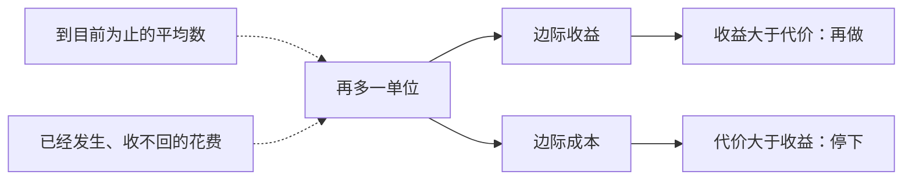

# 理性人考虑边际量

> 学习目标
> - 把全有或全无和再多一单位分开
> - 用 300 美元、花生饮料、500 美元和 10 万美元判断下一张票
> - 解释水便宜、钻石贵跟着哪一个量

<!-- block:section role=intro -->
## 边上再调一点

经济学里说人是理性的，意思是：在办得到的范围内，人会按自己的目标，有条理地比较得失。企业决定雇多少人、做多少产品。个人决定工作多久、收入拿去买什么。这里没有「人品合格」的印章。

生活里的决定也很少是全有或全无。晚饭真正要拍板的，多半是还要不要再添一勺土豆泥，而不是在「完全不吃」和「把厨房吃空」之间二选一。考试前的那一小时也一样。你很少在「整夜不看」和「连续读满一天」之间挑，你是在问：手里多出来的这一小时，要不要拿去看笔记。

这种在现有计划边上做的小幅增减，叫做边际变动。边际就是边上。理性的比较因此也收窄到边上：再多一单位，新得到的好处若大于新付出的代价，就再做一单位；小于，就停。新得到的好处是边际收益，新付出的代价是边际成本。

<!-- block:figure -->

虚线那些量会来敲你的门。下一单位的决定不请它们进房间。

<!-- block:callout variant=key_idea -->
> **要点：** 采取一项行动，当且仅当这一行动的边际收益大于边际成本。全有或全无的大问题，先改写成「再来一点值不值」。

<!-- block:section role=example -->
## 空位上的下一张票，以及一杯水

即将飞越美国的一架飞机有 200 个座位，这趟飞行的成本是 10 万美元。把 10 万除以 200，每个座位平均 500 美元。有人因此觉得，票价不该低于 500 美元。飞机马上起飞，仍空着座位，书里的情景是还空 10 个。候补乘客愿意付 300 美元。卖不卖这一张？

多载这一位，新增加的代价不过是他会吃掉的那包花生和那罐饮料。300 美元高于这点很小的边际成本，卖掉这一张就划算。500 美元回答的是「到目前为止每个座位摊了多少」，它不回答「下一张该不该卖」。10 万美元已经发生。这一张卖出或者留空，那笔钱都收不回来。已经付出、无法收回的花费，叫做沉没成本。它不进入「卖不卖下一张」的比较。

同一条规则也回答一个老问题：水对人不可少，钻石并不是必需，为什么水便宜、钻石贵？人愿意为一件东西付多少，看的是再多一单位带来的好处，而这又取决于他已经有了多少。水到处都有，再多一杯的边际收益很低。钻石稀少，再多一颗的边际收益很高。价格跟着再多一单位的边际收益走，不跟着「总起来有多不可少」走。

把机票和水放在一起看，问法是一样的。不要问这趟航班总共值多少，也不要问水在生命里总起来有多重要。问再多一位乘客、再多一杯水，新的好处和新的代价哪边大。

把数字再问细一点。200 个座位和 10 万美元描述的是整趟飞行的规模，适合回答「这趟航班贵不贵」，不适合回答「还差的那一位要不要带上」。500 美元是把总账摊平。摊平会制造一种错觉：空着的座位也必须各自收回 500 美元。座位却已经空在那里。多带一位，几乎不增加飞机本身的花费，只增加他会消耗的那一点花生和饮料。候补乘客愿意付的 300 美元，是这一步新得的好处。好处大于那一点餐饮，这一步就值得走。已经花掉的 10 万美元不会因为你拒绝他而流回来，所以它不能当作「再拒绝一次就比较划算」的理由。

水与钻石用来挡住另一种错觉：把「不可少」写成「应当贵」。不可少说的是没有它会怎样，那是总量上的地位。价钱说的是再来一单位时，你还愿意放下多少别的东西。水已经很多，再来一杯，你愿意放下的东西很少，所以这一杯便宜。钻石很少，再来一颗，你愿意放下的东西很多，所以这一颗贵。空位机票上的 500 美元犯的是同一类错误。它用一个摊平之后的整体印象，代替了下一步真正增减的那一点。理性在这里就是肯把问题收窄到这一步，而不是给整趟航班或整个生命下一个总判语。

<!-- block:text role=bridge -->
平均数和沉没成本都是真的数字。它们只是回答别的问题。下一张票的房间里，只留 300 美元和花生、饮料。

<!-- block:callout variant=common_pitfall -->
> **误区：** 「平均已经是 500 美元，所以低于 500 就不能卖。」平均描述过去摊下来的账。下一单位只看从现在再往前走一步的增减。

<!-- block:quiz difficulty=mixed num_questions=3 -->
### 1

决定卖不卖这一张候补票，主要比较哪两个量？

- A. 300 美元和 500 美元的平均成本
- B. 300 美元和多载这一位的花生、饮料
- C. 10 万美元和 300 美元
- D. 学费和放弃的工资

答案

B。A 用平均数代替了边际。C 把已经发生的总账拉进了下一张。D 是上大学的账，不是这一张票。

### 2

10 万美元为什么留在「卖不卖下一张」的外面？

- A. 因为航空公司不在乎成本
- B. 因为这笔钱已经发生，卖出或留空都收不回
- C. 因为 300 大于 10 万
- D. 因为花生比机票贵

答案

B。这是沉没成本。下一步做或不做，它都不变。

### 3

水比钻石更不可少，所以水应当更贵。这句话错在哪里？

- A. 价格跟着再多一单位的边际收益，而水再多一杯的边际收益很低
- B. 钻石没有用处，所以价格应为零
- C. 水平均成本高于钻石
- D. 水是沉没成本

答案

A。人已经有很多水时，再一杯的好处很小。钻石稀少，再一颗的好处很大。

<!-- block:flash_cards -->
| front | back | hint |
|---|---|---|
| 边际变动 | 在现有计划边上再增减一点 | 再一勺土豆泥，再一小时笔记 |
| 边际收益大于边际成本 | 再做一单位 | 小于就停 |
| 500 美元 | 每个座位的平均成本 | 不回答下一张 |
| 花生和饮料 | 多载一位乘客的边际成本 | 与 300 美元比 |
| 水和钻石 | 价格跟着再多一单位的边际收益 | 不跟着「总起来多不可少」 |

<!-- block:deep_dive -->
| topic | rationale |
|---|---|
| 企业怎样把「再多一单位」写成日常决策 | 空位机票是一次直觉。后面会把多生产一单位的代价拆成可以收回和不能收回的部分，并在雇人和产量上反复用。这一页只要你肯把平均数请出房间。 |
| 价格为什么会停在边际上 | 水和钻石已经暗示：人们愿付的价钱跟着再多一单位走。整座城市如何用一个报价同时告诉买方和卖方，是市场那一页的事。 |
| 规则改变时，边际的哪一侧被推了一下 | 安全带并不取消「下一公里开多安全」这个问题，它改变更安全驾驶的好处。那是激励，不是另一套成本。 |
