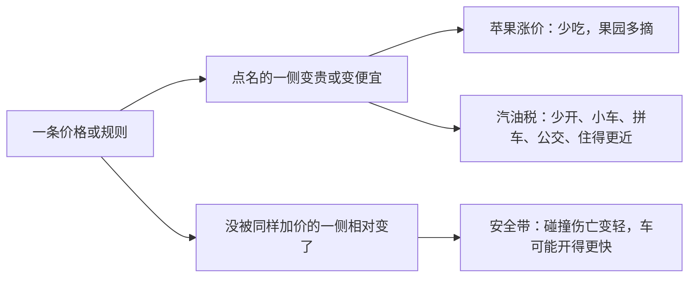

# 人们对激励做出反应

> 学习目标
> - 用苹果说明价格怎样同时推动买方和卖方
> - 列出汽油税之后课本里出现的那些去向
> - 把安全带拆成两列，并说得出佩尔兹曼记下的方向

<!-- block:section role=core -->
## 代价或好处一变，做法就变

激励是会推动人行动的奖赏或惩罚。人既然靠比较代价和好处做决定，这两边只要有一边改了，做法就会改。有人甚至把整门学科收成一句：人会跟着激励走。你不必背这句的出处。要留下的习惯是：看见一条价格或一条规则，先问哪一边变贵了，哪一边变便宜了。

市场里最常见的激励是价格。苹果涨价，人们少吃苹果。果园会多雇人、多摘苹果。较高的价格让买方少要，也让卖方多做。同一条价格，把消费往下按，把生产往上托。你若只记得「涨价不好」，就漏掉了果园那一半。

公共政策用的是同一条肌肉。汽油税把开车的代价抬高。开车变贵以后，人更愿意开更小、更省油的车，也更愿意拼车、坐公共交通、把家安得离工作近一些。欧洲的汽油税高、美国的汽油税低，小型车在欧洲更多，原因之一就在这里。税若再高，会有更多人改开混合动力车；高到一定程度，就会转向电动车。你不必在这一页预测某一个国家明年的车型。你要能顺着「开车变贵」把这些去向说出来。

规则有时只为自己点名的效果标价，人还会去看没被标价的那一列。安全带把这一列补全。20 世纪 50 年代，车上很少有安全带。后来公众关心行车安全，法律要求新车配备。条文想要的效果很直接：一旦碰撞，人更可能活下来。

慢和小心是要花时间、花精神的。司机决定开多稳时，仍在比「更安全」多带来的好处和多付出的代价。路面结冰时车会慢下来，因为这时把车开稳的好处变大了。安全带把碰撞之后伤亡的可能压低，也就把「开得慢、开得小心」的好处压低了。反应和路况变好时相像：车开得更快，也更不那么小心。碰撞的次数上去了。行人更容易被卷进这些碰撞，身上又没有那条安全带。

佩尔兹曼把记录整理成可以对照的几句：单次事故里的死亡少了，事故的件数多了；司机死亡的总人数差不多，行人死亡的人数上去了。点名的那一列变轻了，并不自动等于整体风险下降。读一条政策时，把两列并排：条文写明的效果，以及人因激励而改道之后的效果。

把苹果、汽油税和安全带收回同一句话。苹果涨价，吃苹果变贵，摘苹果变得更值得，于是一边少吃、一边多摘。汽油税让每一公里开车更贵，省油的车、拼车、公共交通和把家搬近工作，就变得相对更值。安全带让碰撞之后活下来更有把握，于是为了安全而开慢、开小心，没那么值得，车速和行人那一列就要另算。三条都是在边际上推一把。你以后遇到一条新的价格或新的规则，也可以先画这两列，再决定要不要只汇报条文自己点名的那一列。只汇报一列，往往会把「人会改道」这件事漏掉。改道不一定表示政策没有意义。它表示意义要在两列一起看完之后才说得全。

<!-- block:figure -->

左边是条文写出来的。右边是人自己找过去的。两列都要留在纸上。

<!-- block:callout variant=insight -->
> **洞见：** 激励接在边际上。安全带没有取消「下一公里开多安全」这个问题，它改的是更安全驾驶的边际收益。变贵的少做，变便宜的多做。

<!-- block:text role=bridge -->
没被点名的那一列，不是用来宣布「这条法律失败了」。它用来防止你只汇报单次事故里的伤亡，就把整体风险说完。

<!-- block:callout variant=warning -->
> **警示：** 司机死亡变化不大、行人死亡上升，要和「每次事故死亡减少」放在一起看。只念其中一句，方向就会反。

<!-- block:quiz difficulty=mixed num_questions=3 -->
### 1

苹果涨价之后，买方和果园分别怎样？

- A. 买方少吃，果园少摘
- B. 买方少吃，果园多雇人、多摘
- C. 买方多吃，因为贵的东西更值得留着
- D. 两边都不变，只有税率会变

答案

B。较高的价格让买方少消费，让卖方多生产。

### 2

汽油税把哪种活动变贵了？下面哪一组去向是课本里写过的？

- A. 开车变贵；更小更省油的车、拼车、公交、住得离工作更近
- B. 读书变贵；人们改去造船
- C. 钻石变贵；人们改喝更多的水
- D. 工资变贵；飞机改按平均成本卖票

答案

A。税再高，还会出现混合动力车，乃至电动车。

### 3

安全带法律最容易被漏掉的一侧是？

- A. 碰撞时人更可能活下来
- B. 人可能把车开得更快、更不小心，行人风险要另看
- C. 货币因此发行过多
- D. 饼被切得更匀

答案

B。A 是点名的那一侧，要写，但不是唯一的一侧。

<!-- block:flash_cards -->
| front | back | hint |
|---|---|---|
| 激励 | 推动人行动的奖赏或惩罚 | 代价或好处一变，做法就变 |
| 苹果涨价 | 少吃；果园多摘 | 买方和卖方都动 |
| 汽油税 | 开车变贵 | 小车、拼车、公交、住得更近 |
| 积冰的路 | 开稳的好处变大，车会慢下来 | 用来对照安全带 |
| 佩尔兹曼记下的方向 | 单次死亡少，事故多；司机死亡差不多，行人死亡上升 | 两列一起看 |

<!-- block:deep_dive -->
| topic | rationale |
|---|---|
| 税收怎样改写买卖双方面对的价格 | 汽油税是一次直觉。后面会把税画进买方付出的价钱和卖方收到的价钱之间。这一页先把「变贵之后人去哪」说全。 |
| 一家企业若能自己决定价格 | 苹果和汽油税都假设人要面对一个给定的价格。若镇上只有一个卖家能把价格定高，激励仍在，但结果可能不再把饼做大。那是市场势力。 |
| 政策设计者信息不全时会怎样 | 安全带的例子已经说明：条文没写到的行为也会动。决策者并非全知。政府那一页会把「出手不一定自动变好」说成一句单独的提醒。 |
