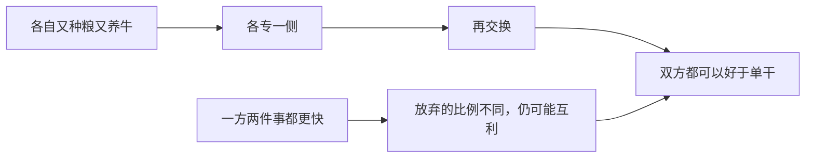

# 贸易可以使每个人状况更好

> 学习目标
> - 说明一方多得并不必然使另一方少得
> - 用种粮与养牛说清比较对象是各自单干
> - 记住更适合看放弃的比例，本页不算数值

<!-- block:section role=intro -->
## 争夺顾客，并不等于交换是零和

厂商会抢同一批顾客。家庭找工作、买东西时也会彼此竞争。竞争很容易被看成一场必须分出胜负的比赛：你多得一截，我就少一截。贸易这一条要改的是这个印象。交换可以让参加的人各自好于不交换的时候。一方多得，另一方并不必然少得。

镜头先放到一个家庭。若这个家庭不和任何人交换，粮食要自己种，衣服要自己做，房子要自己盖。时间被摊在每一件自己并不都擅长的事上。一旦可以交换，每个人就能把时间放在自己更拿手的事上，再用成果换来种类更多、代价更低的东西。国与国之间只是把同一个句子放大：各国去生产自己相对更适合的产品，再彼此交换。

<!-- block:callout variant=key_idea -->
> **要点：** 贸易带来的「更好」，是和各自单干比，不是和平均分配比。

<!-- block:section role=example -->
## 种粮的与养牛的

把家庭的直觉收成两个人。若每个人都又种粮又养牛，时间和技能会被摊薄。一个人相对更适合种粮，另一个相对更适合养牛。各自多做擅长的一侧，再把成果换给对方，双方能得到的组合都可以比各自什么都自己做的时候更好。

「更适合」不是比谁的手脚更快。它看的是机会成本：专做这一侧时，放弃的另一侧有多少。即使有一方种粮和养牛都更快，只要两个人放弃的比例不一样，分工再交换仍可能使双方都越过单干。绝对速度相同与否，不是互利的前提。把比例算成一张数字表，是后面才做的练习。这一页不列表、不求比率。你只要能说出：比较的尺子是放弃了多少别的，不是谁的绝对产量更高。

互利还有两句边界，免得你把它听成另一条原理。它不保证两人分得一样多。它也不保证改行的那几个月里没有人难受。一个人把时间从养牛挪到种粮，短期里可能很别扭。这和「交换能不能让双方越过各自单干」是两件要分开存放的事。分得匀不匀，回到效率与平等那一对，也留在政府为什么有时要改切法的那一条线上。这一页先把「相对单干」说稳。

把不交换的家庭再看慢一点。同一双手既要会种粮食，又要会做衣服，又要会盖房子。每一种技能分到的时间都变薄，不顺手的环节就多。可以交换之后，一个人把时间堆在自己更适合的事上，再用多出来的成果换回自己少做的那些。盘子里的组合可以同时比「样样自己来」更丰富，代价也可以更低。国家之间只是把这句话放大，不是另换一套道理。

绝对速度最容易把这句话听反。若甲种粮和养牛都比乙快，乙好像没有资格进场。可是甲多做一单位粮食时要放弃的牛，和乙多做一单位粮食时要放弃的牛，可以不一样。乙专做自己放弃得较少的那一侧，再与甲交换，乙仍可能比自己又种又养时更好。甲也可以把时间更集中在自己放弃得较少的一侧，从而比自己什么都做时更好。所以「他样样都比我快」并没有关闭互利的门。谁放弃得少、少多少，要列表才知道。列表是后话。这一页要你守住的是尺子：更适合，看的是放弃，不是看谁的手脚更快。互利说的是双方都有机会越过自己的单干，不是说成果会被切成一样大的两份。竞争仍然存在，厂商还是会抢顾客。竞争说明人在争，不说明交换只能有一个赢家。家庭找工作、买东西时的彼此比较，也是同一句话。

<!-- block:figure -->

图的终点是「好于单干」。图上没有「一定平分」。

<!-- block:text role=bridge -->
若你听到「能互利」就接一句「所以结果一定公平」，把刚分开的两件事又粘回去了。公平是切法。互利是越过自给。

<!-- block:callout variant=common_pitfall -->
> **误区：** 「他两件事都比我快，所以跟他交换我一定吃亏。」更快是绝对速度。只要你放弃的比例和他不一样，专做再交换仍可能让你比自己单干时更好。

<!-- block:quiz difficulty=mixed num_questions=3 -->
### 1

种粮的与养牛的各专一侧再交换。这里的「更好」是和谁比？

- A. 和把成果平分之后的状态比
- B. 和各自又种粮又养牛的单干比
- C. 和物价总体是否上升比
- D. 和镇上只有一口井时的高价比

答案

B。互利的基准是单干。A 把平等塞进来了。

### 2

两国厂商争夺同一批顾客，所以贸易一定是一方获利、另一方吃亏。

- A. 对
- B. 不对

答案

B，不对。竞争存在，并不使交换变成零和。人可以专做更适合的事，再换到更多样、代价更低的东西。

### 3

一方种粮和养牛都更快。这一页要求你做什么？

- A. 把两人的比率算到小数点后两位
- B. 记住：放弃的比例不同，仍可能互利；数值先不算
- C. 画出供给曲线和需求曲线
- D. 判断通胀会不会上升

答案

B。数字表是后话。这一页停在机会成本的直觉。

<!-- block:flash_cards -->
| front | back | hint |
|---|---|---|
| 自给的家庭 | 粮食、衣服、房子都自己做 | 交换让人专做更拿手的事 |
| 种粮与养牛 | 各专一侧再交换 | 比较对象是单干 |
| 更适合 | 看专做一侧时放弃的另一侧 | 不是谁绝对更快 |
| 一方两件事都更快 | 放弃比例不同仍可能互利 | 本页不算表 |
| 互利不保证什么 | 不保证平分，也不保证短期没有调整的痛 | 切法是另一条线 |

<!-- block:deep_dive -->
| topic | rationale |
|---|---|
| 把放弃的比例写成数值 | 你已经知道尺子是机会成本。下一步是给两个人各算「多做一单位粮食要放弃多少牛」，再看谁该专做哪一侧。那是一整章的算术，不在这一页。 |
| 交换出来的东西如何被一个报价协调 | 两个人可以面对面换粮和牛。一座城市里的陌生人不会每天开会。价格如何代替这场会，是下一页。 |
| 调整期里谁更难受 | 互利是相对单干的终点比较。人在改行途中可能受损。要不要因此用政策缓和切法，是平等那条理由，不是这一页要裁决的。 |
