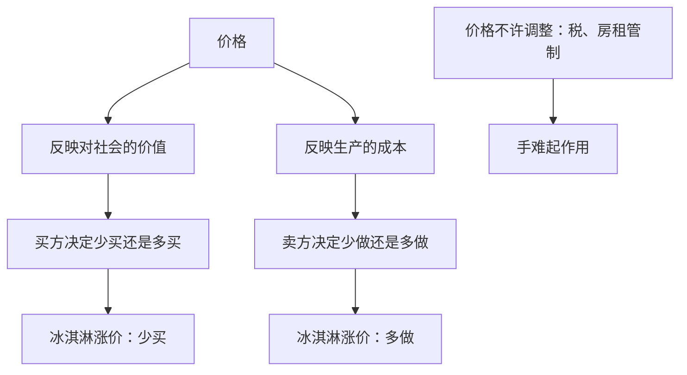

# 市场通常靠价格来组织

> 学习目标
> - 说出市场经济把哪些决定交给企业和家庭
> - 用冰淇淋价格说明看不见的手靠什么协调
> - 指出税收和房租管制挡住的是价格调整

<!-- block:section role=core -->
## 没有总调度的时候，报价在传话

许多人之间的交换需要协调。中央计划者可以规定生产什么、生产多少、谁来生产、谁来消费。这样做要先掌握两样很难集中到一张桌子上的信息：消费者喜欢什么，生产者做成一件东西要花多少。这些信息散落在无数人和无数作坊里。市场经济不把它们先收集到一个总调度手里，而让它们反映在价格上。

在这种安排里，企业决定雇谁、生产什么。家庭决定为谁工作、用收入买什么。他们在市场上相互交易。市场不必是一个具体的摊位。它是许多交换汇在一起的办法。没有人逐户规定晚饭吃什么、工厂明天做多少。

每个人主要关心自己的得失，并没有一位职员专门为「社会整体」值班。结果却常常促进整体的经济福利。亚当·斯密把这只引导称作看不见的手。在这一章里，这只手的载体就是价格。买的人用价格决定买多少，卖的人用价格决定做多少。一个价格里叠着两层：这件东西对社会有多值，以及把它做出来要花多少。许多分散的决定就这样被领到常常对社会更好的结果上。

冰淇淋把两层叠在一个能看见的动作里。价格上涨时，想买的人少买一点，店家更愿意多做一点。双方不必开会清点全城还缺多少盒。报价已经在传递稀缺，并改写节约与增产的激励。你在苹果涨价里见过同一块肌肉：买方少要，卖方多做。这里把那块肌肉放进一整座城市。供给怎样画成一条线、需求怎样画成另一条线、两线在哪里相交，这一页不画。你先要能说出：价格同时是信息和激励。

价格若不许跟着买和卖调整，手就难起作用。税收会扭曲价格。房租管制这一类直接把价格管住，也一样。该变贵的时候变不了，稀缺就传不出去，多做和少用的激励也发不出来。图形留到后面。这一页只要你指出被挡住的那一步：价格调整。

还有两种情况，市场结果未必把社会福利做到最大。一家企业能左右价格。或者一项活动影响到根本没参加这笔交易的人。这两种情况交给下一页。原理说的是市场「通常」是好的组织方式。通常这两个字，就是给例外留的门。

计划者缺的，还可以再说得更具体一点。口味会变，成本会变，而且它们藏在具体的人和具体的作坊里。一位总调度即使很勤快，也很难在每一盒冰淇淋涨价之前，把全城谁还想吃、哪一家店的奶油又贵了，全部问完再下命令。价格把这两件事压成买方和卖方都看得见的一个数。买方觉得值，就继续买；觉得不值，就少买一点。卖方觉得盖得过成本，就多做一点。全城不必先召开一次清点大会。这就是「通常是好方法」里的通常：在价格还能动的时候，分散的决定被一个数协调起来。价格若被税拉开，或被房租管制按住，这个数就不再同时、干净地告诉两边。那时候再谈手还灵不灵，就得先承认传话的那一步已经受阻。

<!-- block:figure -->

没有人清点全城的缺口。报价自己在做这件事，除非它被按住。

<!-- block:callout variant=connection -->
> **关联：** 苹果涨价是一条激励。冰淇淋涨价是整座城市的协调。从「我少吃一点」走到「陌生人不必开会」，用的是同一个价格。

<!-- block:text role=bridge -->
个别一种甜品涨价，是稀缺在通过相对价格说话。先不要把它叫成物价总体上升。总体物价是后面边界页才用的词。

<!-- block:callout variant=warning -->
> **警示：** 「通常是好方法」不是「永远不必再看」。价格被管死、一家独大、或者旁观者被波及的时候，结果可能不再把饼做大。

<!-- block:quiz difficulty=mixed num_questions=3 -->
### 1

这一章里，看不见的手靠什么把分散的决定协调起来？

- A. 一位掌握全部口味和成本的总调度
- B. 价格
- C. 把饼切匀的所得税
- D. 短期里的失业数字

答案

B。计划者恰恰缺少口味和成本的信息。这些信息反映在价格上。

### 2

冰淇淋涨价时，买方和店家需要先开会清点全城还缺多少盒。

- A. 对
- B. 不对

答案

B，不对。想买的人会少买一点，店家更愿意多做一点。报价已经在传递稀缺。

### 3

房租被管制住、不许随供求调整。被挡住的是哪一步？

- A. 产权登记
- B. 价格把价值和成本的变化传给买卖双方
- C. 一小时劳动能生产多少
- D. 旧车是否出过事故

答案

B。价格不能调整，看不见的手就难起作用。这一页不画图。

<!-- block:flash_cards -->
| front | back | hint |
|---|---|---|
| 市场经济里谁做决定 | 企业决定雇谁、生产什么；家庭决定为谁工作、买什么 | 没有总调度逐户规定 |
| 看不见的手 | 人们各自关心自己，价格仍常常把决定领向对社会更好的结果 | 载体是价格 |
| 价格里的两层 | 社会价值，以及生产成本 | 买方看它，卖方也看它 |
| 冰淇淋涨价 | 买方少买，店家多做 | 不必开会 |
| 税和房租管制 | 挡住价格调整 | 手难起作用 |

<!-- block:deep_dive -->
| topic | rationale |
|---|---|
| 供给、需求和相交的那一点 | 你已经知道涨价让一边少买、一边多做。把两边画成曲线、看它们在哪个数量上碰面，是后面的图。这一页先不要用图形代替这句话。 |
| 一家独大时价格还算不算「传话」 | 价格仍是激励。但若卖家能自己把价格定高、少供一点，一些本来值得发生的交换会消失。那是市场势力，下一页用一口井来说。 |
| 税楔在买方付出和卖方收到之间 | 房租管制是把价格按住。税收是把两边看到的价格拉开。两边都让价格不再干净地同时反映价值和成本。图形以后再补。 |
