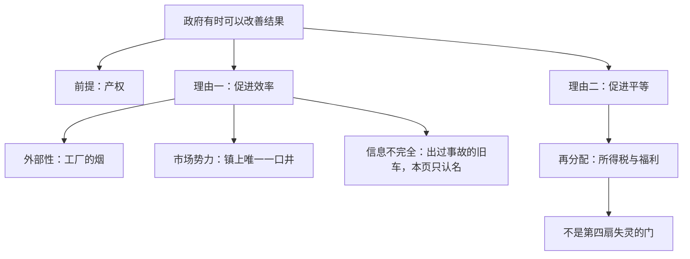

# 政府有时可以改善结果

> 学习目标
> - 用农民、餐馆、影视说明产权
> - 给污染、一口井、旧车各贴对名字
> - 把再分配放在失灵的门外，并记住政策不自动变好

<!-- block:section role=intro -->
## 手要转起来，先得信得过「东西是我的」

看不见的手若常常有效，为什么还要政府？这一页是为了看清它可以在哪里动手，不是为了颁发「只要出手，结果一定更好」的结论。

手转得起来，是因为有人维持规则。其中最要紧的是产权：稀缺的东西可以归某人所有，并由他控制。农民若预料庄稼会被偷走，就不会去种。餐馆若不能确信客人离开前会付钱，就不会供餐。影视若有太多人靠非法复制避开付费，就不会去制作。警察和法院要让人信得过：自己生产出来的东西，权利在自己手里。看不见的手也靠这种信得过。

除此之外，政府介入还有两条宽的理由。一条是促进效率，把饼做大。一条是促进平等，改变饼怎样分。多数政策要么想把饼做大，要么想改切法。两条不要并成一种「市场坏了」。

<!-- block:figure -->

效率下面是市场自己可能做不大饼的几扇门。平等是另一条走廊，不要画进门里。

<!-- block:section role=core -->
## 饼为什么可能做不大，以及切法为什么是另一件事

先走效率。看不见的手多半会把资源送到把饼做大的用途上，例外也有。市场自己到不了有效的配置，就叫市场失灵。这一章让你认出三扇门，先不要把每一扇的后文做完。

第一扇是外部性。工厂生产时把烟排进空气，附近居民的健康受损。这笔代价没有进生产者「再多生产一点」的账单。产量就不会停在把旁观者也算进去的位置上。当事人做了一件事，成本落到了没参加这笔交易的人身上，自己比边际时却没有把这一笔算进去。

第二扇是市场势力。镇上只有一口井，每个人都需要水。井的主人缺少许多竞争者带来的约束，可以少供水、把价格定高。一些本来值得用上的水就用不上。单独一家或一小群人能够把价格定到竞争较多时达不到的水平，就是这扇门。

第三扇是信息不完全。这一页只认名字。卖旧车的人知道这辆车出过没有出过事故，买的人手里只有一个价格。买方若按平均成色出价，好车的主人觉得不划算，好车离开市场，留在市场上的更常常是差车。价格在这里汇总不到那件关键事实。把门认出来即可，不必把信息模型算完。

碰到外部性或市场势力，设计得当的公共政策有机会把效率提高。有机会，不是自动。

再看平等。市场结果就算有效，人与人的日子仍可能差得很远。报酬跟着一种能力走：你能不能做出别人肯付钱的东西。最好的篮球运动员比最好的国际象棋选手挣得更多，因为观众肯为看篮球付更多的钱。看不见的手并不附带一张保证：每个人都有足够的食物、像样的衣服和医疗。

这种差距要不要由政府去收，取决于政治哲学。实践里，所得税和福利制度把经济福利分得更匀一些。这是再分配。税收和转移一改谁分到多少，也会改写工作的激励，于是又回到效率与平等那一对让步。本页不选哪一种分法。

把饼分得更匀，不是第四扇失灵的门。三扇门讲的是市场为什么可能连「饼尽量大」都做不到。平等讲的是：饼即使做大了，切法仍可能让人无法接受。

政策出自政治过程，并不自动把结果改好。有时它酬答有政治力量的人。有时出自好意，但决策者知道的并不全。继续学，是为了能判断一项政策有没有促进效率，或者有没有促进平等。出手的人往往看得到自己点名的效果，看不到人改道之后的效果。好意和信息不足可以同时存在。所以「有机会把效率提高」这句要留着，不能改写成「一动手，饼一定变大」。平等那条也一样：把好处分得更匀，是一条独立的理由，它会改写工作的激励，却不因此变成第四扇失灵的门。

<!-- block:callout variant=common_pitfall -->
> **误区：** 看见收入差距，就把它叫成市场势力。篮球与国际象棋的差距，是报酬跟着别人愿意付的钱走。一口井才是能把价格定高、让水用不上的那一类。

<!-- block:text role=bridge -->
三扇门的漏法不一样。污染漏的是旁观者的账单。井漏的是竞争的约束。旧车漏的是只有卖方知道的事实。不要并成「市场有问题」五个字就收工。

<!-- block:quiz difficulty=mixed num_questions=4 -->
### 1

工厂排污时，产量容易停错位置，主要是因为？

- A. 旁观者的健康成本没有进生产者再多生产一点的账单
- B. 镇上只有这一家，所以它一定是一口井
- C. 买方不知道产品是否出过事故
- D. 政府发行了过多货币

答案

A。这是外部性。B 是另一扇门。C 是旧车。D 是整体经济的边界。

### 2

镇上唯一一口井的主人少供水、把价格定高。这叫什么？少掉的是什么？

- A. 外部性；少掉的是居民的工资
- B. 市场势力；少掉的是一些本来值得用上的水
- C. 再分配；少掉的是平等
- D. 通胀；少掉的是货币

答案

B。缺少竞争者的约束，价格可以被定高，值得用的水用不上。

### 3

旧车的买方按平均成色出价。好车为什么离开？这一页要不要把模型算完？

- A. 好车主人觉得不划算；本页只认这扇门
- B. 好车被井的主人买走；要画供需图
- C. 好车造成污染；要算外部成本公式
- D. 好车代表生产率；要建增长模型

答案

A。卖方知道事故，买方只看见价格。按平均成色出价时，好车退出。展开不在这一页。

### 4

所得税和福利把好处分得更匀。这是第几扇失灵的门？

- A. 第四扇，名叫再分配失灵
- B. 不是失灵的门，是平等那条理由
- C. 就是外部性
- D. 就是市场势力

答案

B。再分配改的是谁分到多少。它会回头影响工作激励，但不要把它塞进三扇门。

<!-- block:flash_cards -->
| front | back | hint |
|---|---|---|
| 产权的三句 | 农民怕偷就不种；餐馆怕白吃就不供餐；影视怕被白拷就不制作 | 手靠权利被执行 |
| 外部性 | 成本或好处落到交易之外的人身上，当事人的边际里没有这一笔 | 工厂的烟 |
| 市场势力 | 一家或一小群人能把价格定到竞争较多时的水平之外 | 镇上的一口井 |
| 信息不完全 | 一方掌握另一方没有的关键事实 | 旧车；本页只认名 |
| 再分配 | 改变谁分到多少 | 不是第四扇门 |

<!-- block:deep_dive -->
| topic | rationale |
|---|---|
| 把旁观者的成本加回「再多一单位」 | 你已经知道烟尘没进账单。下一步是问：若把居民的健康代价算进生产者的边际成本，产量会停在哪里，以及一条税或一条规则能不能帮这个忙。那是外部性自己的一章。 |
| 缺少竞争时价格高到什么程度 | 一口井给出方向：少供、定高、值得用的水用不上。垄断如何定价、寡头如何彼此看着办，是后面几章的模型。这一页停在认出门。 |
| 只有一方知道质量时，谁退出 | 旧车是认名用的情景。平均成色的出价如何把好货赶走，有一整套说法。本页不要求你把那套说法算完。 |
