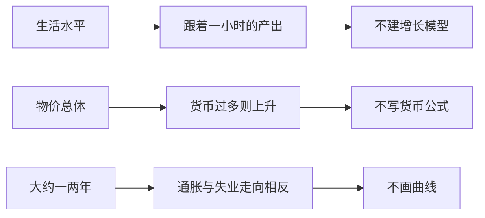

# 整体经济的三条边界

> 学习目标
> - 用一小时的产出说出生活水平差别的落点
> - 把个别物品涨价和物价总体上升分开
> - 说出短期权衡的方向，并拒绝在本页画曲线或写公式

<!-- block:callout variant=warning -->
> **警示：** 这一页只留三句可以停住的话。生活水平、货币和短期失业可以各认一个课本锚。增长模型不建，货币公式不写，通胀与失业的曲线不画。

<!-- block:section role=core -->
## 三句边界，各有一个锚

前面的页在看一个人怎样让步，以及人与人怎样交换。这一页把镜头拉到经济整体，然后主动停住。三条都只回答「差别或波动大致从哪来」，不往下拆模型。

第一条：一国的生活水平，取决于它生产物品与劳务的能力。各国的日子可以差得很远，一国自己过几十年也可以差得很远。这些差别几乎都可以归到生产率，也就是一小时劳动能够生产多少物品与劳务。工人每小时生产得多的地方，大多数人的日子更宽裕。生产得少的地方，大多数人更拮据。生产率提高得快，平均收入也提高得快。

想把生活水平托上去，要问政策会不会让劳动者受到更好的教育、用上更好的工具和技术，从而提高每小时的产出。把主因主要记在工会、最低工资或外国竞争上，问法就偏了。更忙、工时更长，也不等于每一小时生产得更多。这一页停在：生活水平跟着生产能力走。

第二条：政府发行了过多货币时，物价上升。这里的物价是总体水平，不是某一种物品。一种水果因为歉收而涨价，是相对价格，前面那页的报价仍可能在传递稀缺。通胀指的是物价总体往上走。

物价若大幅上涨，或持续地上涨，原因几乎总是货币变多了。货币多了，每一单位货币能换到的东西就变少。一个能记住的锚是 20 世纪 20 年代初的德国：1921 年 1 月，一份报纸大约 0.30 马克；到 1922 年 11 月，同一份报纸标价 7000 万马克，其他物价同样飞涨。同期货币数量也在以相近的速度增加。美国没有走过那种极端。20 世纪 70 年代，物价总体的上涨成了严重问题，并伴随着较快的货币增长；后来通胀较低的年份，货币增长也较慢。这一页停在：货币发得过多，物价上升。不要在这里写一条货币公式。

第三条：社会在短期里面临通胀与失业之间的权衡。货币增加在长期里主要推高物价。短的那一段要分开看。经济里的货币多了，整体支出上来，对物品与劳务的需求增加。企业会逐步改价。在价格还没有全部改完之前，会先多雇人、多生产。多雇人意味着失业下降。于是大约一两年里，许多政策把通胀和失业推向相反的方向。

政府花多少、税怎么收、货币发行多少，都会牵动整体需求，于是也牵动短期里这两件事如何搭配。2008、2009 年的衰退用来说明争论在争什么：把整体支出做上去，是为了压低失业；也有人担心物价被推高。这一页不判那场争论的胜负，也不画曲线。方向只留两句。急着压低通胀，短期里失业可能先上升。急着把支出做上去，失业可能先下降，物价面临上升的压力。

这三条里的「权衡」和枪炮与黄油不是同一对。枪炮与黄油是资源去国防还是去消费品。这里是整体经济在大约一两年里，通胀和失业被推向相反方向。时间范围也不同：长期里，过多的货币主要推高物价。

<!-- block:figure -->

每一句旁边都有一件明确不做的事。能复述卡片，这一页就够了。

<!-- block:text role=summary -->
个别物品涨价先回到价格那一页。只有物价总体持续或大幅上升，才把锚放到货币上。失业和通胀的相反方向，只在短期里使用。

<!-- block:quiz difficulty=mixed num_questions=3 -->
### 1

某一种水果因为歉收而涨价。这是通胀吗？

- A. 是，只要有东西涨价就是通胀
- B. 不一定。通胀是物价总体上升；一种物品涨价可以只是相对价格
- C. 是，而且一定来自一口井
- D. 是，而且说明饼被切匀了

答案

B。相对价格仍可能是稀缺在通过报价说话。通胀看的是总体水平。

### 2

想提高生活水平，这一页要你把问题主要问到哪里？

- A. 教育、工具和技术能否提高每小时的产出
- B. 主要问工会、最低工资和外国竞争
- C. 主要问安全带有没有系上
- D. 主要问冰淇淋涨了没有

答案

A。不要把生活水平的主因主要记在工会、最低工资或外国竞争上。

### 3

原理里那条通胀与失业的权衡，时间范围是？

- A. 永远相反，所以可以长期靠更高通胀换零失业
- B. 大约一两年的短期；长期里货币过多主要推高物价
- C. 只在 1921 年的德国成立
- D. 只在枪炮与黄油里成立

答案

B。2008、2009 年的争论这一页不判胜负，也不画曲线。

<!-- block:flash_cards -->
| front | back | hint |
|---|---|---|
| 生产率 | 一小时劳动生产的物品与劳务 | 生活水平跟着它 |
| 不要把主因记在哪 | 工会、最低工资、外国竞争 | 要问教育、工具、技术 |
| 通胀 | 物价总体上升 | 一种水果涨价不一定是 |
| 德国报纸 | 约 0.30 马克到 7000 万马克 | 货币也增加得很快 |
| 短期权衡 | 大约一两年里，通胀与失业走向相反 | 不画曲线 |

<!-- block:deep_dive -->
| topic | rationale |
|---|---|
| 什么推动每一小时的产出 | 教育、工具和技术只是方向。资本如何积累、想法如何变成可用的技术，是增长本身的问题。这一页不打开那套模型。 |
| 货币数量和总体物价之间的那条关系 | 报纸的锚告诉你方向：货币过多，物价上升。把关系写成公式、再讨论速度，是货币理论。本页停在方向。 |
| 通胀与失业的那条线为什么只在短期斜着 | 你已经有「大约一两年」和「长期主要是物价」。线的斜率和政策能否挪动它，是宏观里的曲线。本页不画。 |
