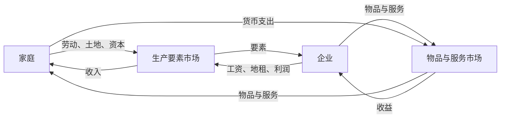

# 第一个模型：循环流量图

| | |
|---|---|
| 表面 | Book |
| 用时 | 约 10 分钟 |
| 原书 | 曼昆《经济学原理》微观分册第 8 版 · 第 2 章 · 循环流量图 |
| 本章深度 | 会用 |
| 导航 | [学习台](../README.md) · [上一页](01_scientist.md) · [下一页](03_ppf.md) |

## 学完你能做什么

- 说出两个市场里谁买、谁卖。
- 讲清实物和货币为什么方向相反。
- 指出这张图故意没画政府和国际贸易。

## 概念讲解

经济里有千百万人在买、卖、工作和雇用。要看出它怎样组织起来，需要一张简图，把这些活动收成能记住的几块。循环流量图就是这张图。

决策者收成两类。**企业**用劳动、土地和资本生产物品与服务。资本在这里指建筑物和机器这一类投入。这些投入合称 **生产要素**。**家庭**拥有生产要素，并消费企业生产的物品与服务。企业所有者也是家庭里的人。

两类人在两个市场上交易。

| 市场 | 买者 | 卖者 | 场上换的是什么 |
|---|---|---|---|
| 物品与服务市场 | 家庭 | 企业 | 家庭购买企业生产的物品与服务 |
| 生产要素市场 | 企业 | 家庭 | 家庭提供劳动、土地和资本 |

图上有两圈，方向相反。里面一圈是投入与产出：家庭把劳动、土地和资本卖给企业；企业用这些要素生产物品与服务，再卖回给家庭。外面一圈是货币：家庭花钱买物品与服务；企业用一部分销售收入支付要素的报酬，例如工资、地租，剩下的是利润。利润回到作为所有者的家庭。东西往这边走，钱往对面走。

拿一张钞票走一圈，方向就具体了。它先在某个家庭的钱包里。拿到物品与服务市场买一杯咖啡，它进了店里的收银机，成为企业的收益。它停不久。企业要在生产要素市场上付房租或工资。这张钞票又成为某个家庭的收入，回到一只钱包，循环再开始。

上边那一串是实物：要素进企业，物品与服务回家庭。下边那一串是货币，方向相反。

这是简化。更完整的图会放进政府和国际贸易。付出去的那一杯咖啡，可能有一部分变成税，咖啡豆也可能来自国外的农户。这些细节对「经济大体怎样接在一起」不是必须的。记这张图，是为了想各部分如何拼起来时有一个底图。

> [!NOTE]
> **标注 · 课本例子**  
> 一杯咖啡的钞票：钱包 → 物品与服务市场的收银机 → 生产要素市场上的工资或房租 → 另一只钱包。

> [!WARNING]
> **注意**  
> 两个市场的买者和卖者是对调的。家庭在物品市场上买，在要素市场上卖。企业正好相反。说成「家庭总是买者」，这张图就读反了。

> [!TIP]
> **关键术语**  
> **循环流量图**：货币怎样通过市场在家庭与企业之间流动的简图。内圈是投入与产出，外圈是货币。  
> **生产要素**：劳动、土地，以及建筑物和机器等资本。  
> **物品与服务市场**：家庭买、企业卖。  
> **生产要素市场**：家庭卖、企业买。

> [!IMPORTANT]
> **深度解析**  
> 政府和国外贸易是故意没画的，不是现实里没有。模型的用处是留下「谁和谁在哪个市场上交换」。要问税收或进口时，再把这些部分加回去。

## 小测验

### B02-1 · 选择

在生产要素市场上，谁是买者，谁是卖者？

- A. 家庭买，企业卖
- B. 企业买，家庭卖
- C. 两边都只卖不买
- D. 政府买，家庭卖

要点

B。家庭提供劳动、土地和资本。企业购买这些要素。A 说的是物品与服务市场。基本的这张图里没有政府。

### B02-2 · 判断

循环流量图的基本形式已经画进了政府和国际贸易。

要点

不对。政府和国际贸易是这张图故意省略的。一杯咖啡的钱可能有一部分变成税，咖啡豆也可能来自国外，但底图先不画这些。

### B02-3 · 简答

一张用来买咖啡的钞票，怎样又回到一只钱包？实物和货币的方向有什么关系？

要点

钞票从家庭到物品市场，成为企业收益，再被企业用来付工资或房租，成为另一个家庭的收入。实物（要素、物品与服务）和货币方向相反。

## 本页带走

两类决策者，两个市场。家庭在物品市场买、在要素市场卖；企业相反。实物和货币是同一笔交易的两面。政府与国际贸易是这张图故意没画的。

下一页读第二个模型：[生产可能性边界](03_ppf.md)。

掌握路径上，本页对应 [C2-R03](../PRACTICE.md#c2-r03)、[C2-R04](../PRACTICE.md#c2-r04)。
